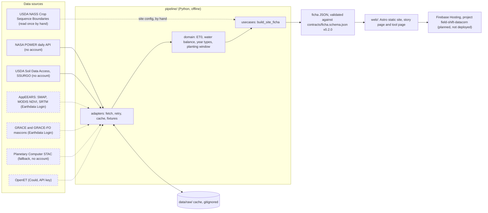

<!-- SI-assisted (Claude Code); reviewed by <name> -->
# Data sources, APIs and connections

The register of every data source, API and account behind Field Shift. It is the file issue [#16](https://github.com/RikepilB/Data_corn/issues/16) asks for. Citations and licences live in [REFERENCES](REFERENCES.md); account and offer status in [ACCOUNTS](setup/ACCOUNTS.md); the system design in [ARCHITECTURE](architecture/ARCHITECTURE.md). Index of all planning documents: [planning README](planning/README.md).

## 1. How to read this register

- **Status words.** *Verified* means a request was made on the stated date and returned the stated result. *To verify* means nobody has checked it against the source yet. *Not used* means no plan task uses it.
- **A probe proves access, not completeness.** The probes of 2026-11-14 show that three services answer. None of them shows that the data cover 1981-2025 without gaps.
- **Tier** is Must, Should, Could, Fallback or Not used, as in the cut lines of the [MVP](planning/MVP.md).
- **Where a fact comes from.** Endpoints, SQL and request parameters come from the [implementation plan](superpowers/plans/2026-11-14-field-shift-mvp.md) (Tasks 2, 4, 10, 11, 15). Licences come from REFERENCES and are still marked "verify" there.
- **The only NASA data family on the Must path is POWER.** SMAP, MODIS, SRTM and GRACE are Should. If every Should item is cut, "NASA data central to the solution" rests on POWER (including the MERRA-2 and CERES products behind it, section 3). That still meets the rule of at least one NASA dataset.

## 2. Summary

| # | Source | Role in the solution | Tier | NASA data | Account | Status |
|---|---|---|---|---|---|---|
| S1 | NASA POWER daily point API | Climate forcing, ET0, year types, planting window | Must | Yes (NASA LaRC) | None | Access verified 2026-11-14; coverage to verify |
| S2 | USDA NRCS SSURGO through Soil Data Access | Soil available water, texture | Must | No | None | Access verified 2026-11-14; horizon completeness to verify |
| S3 | USDA NASS Crop Sequence Boundaries and CDL | Current rotation of the pilot field, read once | Must | No | None | To verify |
| S4 | SMAP `SPL3SMP_E.006` through AppEEARS | Consistency check of simulated moisture | Should | Yes (NSIDC DAAC) | Earthdata Login | To verify |
| S5 | MODIS `MOD13Q1.061` through AppEEARS | NDVI crop calendar and bare windows | Should | Yes (LP DAAC) | Earthdata Login | To verify |
| S6 | SRTM `SRTMGL1_NC.003` through AppEEARS | Slope for the erosion index | Should | Yes (LP DAAC) | Earthdata Login | To verify |
| S7 | GRACE and GRACE-FO mascons | Regional water-storage context | Should | Yes (PO.DAAC) | Earthdata Login | Product short name unverified |
| S8 | OpenET | Field evapotranspiration cross-check | Could | Consortium product (Landsat-based) | API key | To verify; decision at Checkpoint 3 |
| S9 | Microsoft Planetary Computer STAC | NDVI fallback | Fallback | Hosts NASA products | None to read | Catalogue root verified 2026-11-14 |
| S10 | GPM IMERG, HLS, Copernicus Sentinel-2, Google Earth Engine | None in the plan | Not used so far | Partly | Varies | Open decision for IMERG ([#16](https://github.com/RikepilB/Data_corn/issues/16)) |
| S11 | SoilGrids, ONI, ICEN, Meteomatics, GLDAS | None | Not used | No | None | Not used after the pivot |

## 3. Sources in detail

### S1. NASA POWER daily point API (Must)

| Field | Value |
|---|---|
| Role | Climate forcing for the soil-water twin. ET0 uses `T2M_MAX`, `T2M_MIN`, `RH2M`, `WS2M` and `ALLSKY_SFC_SW_DWN`. Rain is `PRECTOTCORR`. Year types use April-September rain. The planting window uses `TSOIL1` and Tmin. `GWETTOP` (surface soil wetness, 0 to 1) is fetched with the rest, but no plan task uses it yet. |
| Product and endpoint | NASA POWER daily API, point query, AG community: `https://power.larc.nasa.gov/api/temporal/daily/point`. Parameters `T2M_MAX,T2M_MIN,RH2M,WS2M,ALLSKY_SFC_SW_DWN,PRECTOTCORR,TSOIL1,GWETTOP`, output JSON. One request per calendar year, cached. API version string: to verify. |
| Access and registration | None. |
| Auth | None. |
| Coverage | Any latitude and longitude. Target record 1981-2025, about 16 400 daily rows. **To verify:** per the POWER documentation (search summary, see the table below) meteorology starts on 1981-01-01 but the solar parameter starts on 1984-01-01, so `ALLSKY_SFC_SW_DWN`, and with it ET0, may be missing for 1981-1983. The check is the NaN count of `rs_mj` for 1981-1983 in the live run of Task 2 ([#36](https://github.com/RikepilB/Data_corn/issues/36)). Fill value -999 must become NaN, never 0. |
| Licence and citation | NASA open data policy (verify), per REFERENCES. The exact citation text for POWER and its upstream products is to verify. |
| Fallback | Every response is cached under `data/raw/` (gitignored), a small recorded fixture is committed, and the adapter retries with backoff, so the demo never depends on a live call. |
| Status | Access verified 2026-11-14 at 39.36, -100.44: HTTP 200, `TSOIL1` in °C and `GWETTOP` between 0 and 1. Coverage and NaN counts to verify ([#36](https://github.com/RikepilB/Data_corn/issues/36), [#16](https://github.com/RikepilB/Data_corn/issues/16)). |

Example request, as the adapter builds it (Task 2). Use PowerShell or `curl.exe`: Git-Bash `curl` fails TLS against this host on one team machine.

```powershell
curl.exe -s "https://power.larc.nasa.gov/api/temporal/daily/point?parameters=T2M_MAX,T2M_MIN,RH2M,WS2M,ALLSKY_SFC_SW_DWN,PRECTOTCORR,TSOIL1,GWETTOP&community=AG&longitude=-100.44&latitude=39.36&start=20250401&end=20250410&format=JSON"
```

Expected: HTTP 200, `TSOIL1` in °C, `GWETTOP` unitless between 0 and 1 (as observed on 2026-11-14).

**What feeds POWER.** Issue [#16](https://github.com/RikepilB/Data_corn/issues/16) asks us to say which NASA products sit behind POWER, so that the claim "NASA data central to the solution" is exact. The table is from a web-search summary of the POWER data-sources page, [power.larc.nasa.gov/docs/methodology/data/sources](https://power.larc.nasa.gov/docs/methodology/data/sources/), read on 2026-11-14. The page itself was not opened, so everything in it is **to verify**.

| POWER parameters | Upstream source | Period | Native grid |
|---|---|---|---|
| `T2M_MAX`, `T2M_MIN`, `RH2M`, `WS2M` | GMAO MERRA-2, a reanalysis (a model that assimilates many observations) and not a single mission. GEOS-IT is appended to the end of the daily series for low latency. | From 1981-01-01 | 1/2 degree latitude by 5/8 degree longitude |
| `TSOIL1`, `GWETTOP` | MERRA-2 top soil layer, as stated in [ARCHITECTURE](architecture/ARCHITECTURE.md) | To verify | About 0.5 degrees (to verify) |
| `ALLSKY_SFC_SW_DWN` | NASA SRB Release 4 Integrated Product (1984-01-01 to 2000-12-31), then CERES SYN1deg from 2001, with FLASHFlux for the most recent period | From 1984-01-01 | 1 degree by 1 degree |
| `PRECTOTCORR` | **Not confirmed.** The summary did not mention it. Check the POWER parameter dictionary. It matters because the dry, normal and wet split depends on it. | To verify | To verify |

[ARCHITECTURE](architecture/ARCHITECTURE.md) labels POWER as about 0.5 degrees. If the solar grid is 1 degree, the ficha's `provenance.inputs[].resolution` should name both grids.

### S2. USDA NRCS SSURGO through Soil Data Access (Must)

| Field | Value |
|---|---|
| Role | Soil horizons at the field point give total available water (TAW, mm of water per m of soil) for the twin, and sand, clay and organic matter for `site.soil` in the ficha. TAW is the mean `awc_r` (cm/cm) × 1000 mm/m, depth-weighted to 150 cm and weighted by component percentage. |
| Product and endpoint | USDA NRCS Soil Data Access, tabular service: `https://SDMDataAccess.sc.egov.usda.gov/Tabular/post.rest`. POST a JSON body `{"query": <SQL>, "format": "JSON+COLUMNNAME"}`. The query joins `mapunit`, `component` (major components only) and `chorizon` for the map unit at the point. The SSURGO survey version is to be recorded in the provenance (to verify). |
| Access and registration | None. |
| Auth | None. |
| Coverage | The pilot point is covered (probe). Completeness of horizons down to 150 cm: to verify ([#16](https://github.com/RikepilB/Data_corn/issues/16)). |
| Licence and citation | Public domain, U.S. Government work (verify), per REFERENCES. |
| Fallback | Cache the response. If the service is slow or down, use a typed texture class with the Saxton and Rawls (2006) estimate, labelled `assumed`. |
| Status | Access verified 2026-11-14 at 39.36, -100.44: HTTP 200, Keith silt loam, 1 to 3 percent slopes, `awc_r` 0.21, about 210 mm/m. Horizon completeness to verify. |

The query of Task 4, at the probe point (sketch for a Windows machine; the adapter's `post_json` sends the same body):

```powershell
$sql = "SELECT mu.mukey, mu.muname, c.compname, c.comppct_r, ch.hzdept_r, ch.hzdepb_r, " +
       "ch.sandtotal_r, ch.claytotal_r, ch.om_r, ch.awc_r " +
       "FROM mapunit mu " +
       "INNER JOIN component c ON c.mukey = mu.mukey " +
       "INNER JOIN chorizon ch ON ch.cokey = c.cokey " +
       "WHERE mu.mukey IN (SELECT * FROM SDA_Get_Mukey_from_intersection_with_WktWgs84('point(-100.44 39.36)')) " +
       "AND c.majcompflag = 'Yes' " +
       "ORDER BY c.comppct_r DESC, ch.hzdept_r"
$body = '{"query": "' + $sql + '", "format": "JSON+COLUMNNAME"}'
Invoke-RestMethod -Method Post -Uri "https://SDMDataAccess.sc.egov.usda.gov/Tabular/post.rest" -ContentType "application/json" -Body $body
```

### S3. USDA NASS Crop Sequence Boundaries and CDL (Must)

| Field | Value |
|---|---|
| Role | The current rotation of the pilot field, read once by hand ([#19](https://github.com/RikepilB/Data_corn/issues/19)). It sets the `is_current` rotation and, without NDVI, the assumed calendar. The pipeline makes no call to it. |
| Product and endpoint | Crop Sequence Boundaries (USDA NASS and ERS): field-like polygons with several years of crop history derived from the Cropland Data Layer. The research note says 8 years per polygon, released in 2023. The release and years to use are to verify. Page: [nass.usda.gov, Crop Sequence Boundaries](https://www.nass.usda.gov/Research_and_Science/Crop-Sequence-Boundaries/). The CDL (CropScape) can be used to read single years; its address is to confirm in [#19](https://github.com/RikepilB/Data_corn/issues/19). |
| Access and registration | Public download from NASS. No account (to verify). |
| Auth | None (to verify). |
| Example | Manual, once: find the polygon at the pilot point, copy its crop sequence and years, and cite the release. |
| Coverage | US cropland; the pilot point is to verify. |
| Licence and citation | Public domain, provided "as is" (verify), per REFERENCES. |
| Fallback | Ask a mentor or extension contact ([#27](https://github.com/RikepilB/Data_corn/issues/27)). Otherwise use the team plan's proposed current rotation (continuous corn with irrigation), labelled `assumed`. |
| Status | To verify. No probe yet. |

### S4. SMAP `SPL3SMP_E.006` through AppEEARS (Should)

| Field | Value |
|---|---|
| Role | A consistency check of simulated rainfed soil-moisture anomalies against SMAP at the 9 km pixel, 2015-2025, for the current rotation only. It never validates the alternatives. |
| Product and endpoint | SMAP Enhanced L3 radiometer soil moisture `SPL3SMP_E`, version 006 (`SPL3SMP_E.006`), 9 km, NSIDC DAAC. Layers: AM soil moisture and its retrieval QA. The layer name used in the plan's test is `Soil_Moisture_Retrieval_Data_AM_soil_moisture`; confirm it in the real CSV. Requested through AppEEARS: [appeears.earthdatacloud.nasa.gov](https://appeears.earthdatacloud.nasa.gov). |
| Access and registration | A NASA Earthdata Login (free, one per person) and authorising the NSIDC application. |
| Auth | Earthdata Login. AppEEARS uses the same login. |
| Example | One AppEEARS point sample at the pilot site, CSV output, 2015-04-01 to 2025-12-31, with these layers: `SPL3SMP_E.006` AM soil moisture and its retrieval QA; `MOD13Q1.061` NDVI and pixel reliability; `SRTMGL1_NC.003` elevation. Not a script: it is submitted in the AppEEARS interface ([#18](https://github.com/RikepilB/Data_corn/issues/18)). |
| Coverage | From 2015. SMAP L3 senses about the top 0 to 5 cm, so anomalies are compared, never absolute values. The 9 km pixel in western Kansas mixes center pivots and dryland, and the ficha's validation note says so. The check needs at least 24 valid months, otherwise `not-available`. |
| Licence and citation | NASA open data policy (verify), per REFERENCES. |
| Fallback | `validation.status` is `not-available` and cell confidence is capped at medium. Mentor question 6 asks whether to use the L4 product `SPL4SMGP` instead. |
| Status | To verify. As of Saturday afternoon, 2026-11-14, Earthdata Login is not set up and the request is not submitted ([#17](https://github.com/RikepilB/Data_corn/issues/17), [#18](https://github.com/RikepilB/Data_corn/issues/18)). |

### S5. MODIS `MOD13Q1.061` through AppEEARS (Should)

| Field | Value |
|---|---|
| Role | An NDVI series at the field point to detect planting, peak and harvest and the bare windows between seasons. |
| Product and endpoint | MODIS Vegetation Indices, 16-day, `MOD13Q1` version 061, 250 m, LP DAAC. NDVI and the pixel reliability layer, in the same AppEEARS request as S4. |
| Access and registration | Earthdata Login (authorise LP DAAC if AppEEARS asks). |
| Auth | Earthdata Login. |
| Coverage | From 2000 (per REFERENCES). 16-day composites, with gaps where clouds or snow block the view. A gap longer than 48 days never creates a season (Task 11). |
| Licence and citation | NASA open data policy (verify), per REFERENCES. |
| Fallback | NDVI from the Planetary Computer STAC (S9), or `calendar.status = assumed` from the site config. |
| Status | To verify. |

### S6. SRTM `SRTMGL1_NC.003` through AppEEARS (Should)

| Field | Value |
|---|---|
| Role | Slope for the relative erosion index. Elevation is also needed for ET0 on the Must path: see the gaps in section 4. |
| Product and endpoint | SRTM, `SRTMGL1_NC.003`, 30 m, LP DAAC, in the same AppEEARS request as S4. REFERENCES lists it as `SRTMGL1` version 003; the plan and the issues use `SRTMGL1_NC.003`. The two names are to reconcile. |
| Access and registration | Earthdata Login. |
| Auth | Earthdata Login. |
| Coverage | 30 m. That the pilot point lies inside the product is to verify. |
| Licence and citation | NASA open data policy (verify), per REFERENCES. |
| Fallback | The SSURGO slope-class midpoint, or the plan's defaults of slope 2% (Keith, 1 to 3%) and K-factor 0.03, with an information gap that names the default (Task 9). |
| Status | To verify. |

### S7. GRACE and GRACE-FO mascons (Should)

| Field | Value |
|---|---|
| Role | The regional water-storage trend, as context for the story: why water matters here. About 300 km wide, so it never speaks about one field or one well. |
| Product and endpoint | JPL GRACE and GRACE-FO mascon grid, PO.DAAC: monthly total water storage anomaly as liquid water equivalent thickness (`lwe_thickness`, cm), from 2002. The plan assumes the short name `TELLUS_GRAC-GRFO_MASCON_CRI_GRID_RL06.3_V4`. **That short name is unverified.** Confirm it in Earthdata Search before coding ([#20](https://github.com/RikepilB/Data_corn/issues/20)). |
| Access and registration | Earthdata Login (authorise PO.DAAC). Read through the `earthaccess` library, an optional extra of the pipeline. |
| Auth | Earthdata Login. |
| Coverage | Monthly from 2002. The gap between the two missions (2017-07 to 2018-05) is never interpolated. Footprint about 300 km. |
| Licence and citation | NASA open data policy (verify), per REFERENCES. |
| Fallback | No `water_context` block, and the web shows nothing. Go or no-go is decided by Checkpoint 3. |
| Status | Product short name unverified ([#20](https://github.com/RikepilB/Data_corn/issues/20)). |

### S8. OpenET (Could)

| Field | Value |
|---|---|
| Role | Field evapotranspiration, as an ET cross-check only. The research note says the 2024 global winner combined SMAP and OpenET for planting windows. |
| Product and endpoint | OpenET ensemble, 30 m, Landsat-based (per REFERENCES). API version: to verify. |
| Access and registration | A free account and an API key, requested only if the Must and Should items are green by Checkpoint 3. |
| Auth | API key, kept out of the repo and never committed. |
| Coverage | The research note says it is used in Kansas (to verify). |
| Licence and citation | To verify. |
| Fallback | Drop it. |
| Status | To verify. The decision "use or drop" is due at Checkpoint 3 ([#21](https://github.com/RikepilB/Data_corn/issues/21)). |

### S9. Microsoft Planetary Computer STAC (Fallback)

| Field | Value |
|---|---|
| Role | A no-account fallback for NDVI if the AppEEARS queue stalls (lane D), and a possible source of imagery collections. |
| Product and endpoint | STAC API: `https://planetarycomputer.microsoft.com/api/stac/v1`. The catalogue includes Sentinel-2 L2A, Landsat and MODIS (per ACCOUNTS). The collection to use for NDVI is to verify. |
| Access and registration | None to read the catalogue. Whether downloading assets needs signed URLs is to verify. |
| Auth | None to read. |
| Coverage | Per collection (to verify). |
| Licence and citation | Per collection (to verify). |
| Fallback | If it also fails, the calendar is `assumed`. |
| Status | Catalogue root verified 2026-11-14 (`GET /api/stac/v1` returned 200). Collections and asset access to verify. |

Probe, as run on 2026-11-14 (PowerShell):

```powershell
curl.exe -s -o NUL -w "%{http_code}" https://planetarycomputer.microsoft.com/api/stac/v1
```

### S10. Listed in the team documents, but no plan task uses them

| Source | Where it appears | What is open |
|---|---|---|
| GPM IMERG Final daily, `GPM_3IMERGDF` V07 (GES DISC) | REFERENCES ("planned": rainfall cross-check, erosivity); the demo-slide draft in the [team action plan](TEAM-ACTION-PLAN.es.md); the Earthdata row of the accounts table | Issue [#16](https://github.com/RikepilB/Data_corn/issues/16) asks the team to decide. If it is not used, drop it from the slide and mark it `not used` in REFERENCES. |
| HLS, `HLSL30` and `HLSS30` version 2.0 (LP DAAC) | REFERENCES ("planned": finer NDVI, stretch) | No task. |
| Copernicus Sentinel-2 L2A (ESA) and Copernicus Data Space | REFERENCES (stretch); the slide draft; optional offers in [#15](https://github.com/RikepilB/Data_corn/issues/15) | No task. Only if MODIS NDVI is not enough. |
| Google Earth Engine (noncommercial) | Optional offers in [#15](https://github.com/RikepilB/Data_corn/issues/15) | Registration review can take time. Planetary Computer is the no-wait fallback. |

### S11. Not used

| Source | Why it is not used |
|---|---|
| SoilGrids 2.0 (ISRIC) | Replaced by SSURGO after the pivot |
| Oceanic Niño Index (NOAA CPC) and Índice Costero El Niño (ENFEN and IGP) | Replaced by dry, normal and wet years after the pivot |
| Meteomatics weather API | An optional sign-up of the global offers. Not on the Must path and not used. |
| GLDAS | Named in ACCOUNTS as an Earthdata use, but no task uses it |

## 4. Gaps in the register

1. **Elevation for ET0.** ET0 needs the site elevation on the Must path. It is a site-config value recorded with the pilot field ([#19](https://github.com/RikepilB/Data_corn/issues/19)), and no source is named. SRTM through AppEEARS is a Should and may not arrive.
2. **`GWETTOP`.** It is fetched, but no plan task consumes it. Use it, or drop it from the request.
3. **`PRECTOTCORR` provenance.** Not confirmed in the POWER documentation read so far (section 3, S1).
4. **K-factor and slope defaults.** The defaults of 0.03 and 2% come from the plan without a cited source ([#25](https://github.com/RikepilB/Data_corn/issues/25)).
5. **Crop Sequence Boundaries release and years.** To be fixed and cited in [#19](https://github.com/RikepilB/Data_corn/issues/19).

## 5. How the sources connect

Solid arrows are the Must path. Dashed arrows are Should, Could or fallback sources. The arrows show the flow of data, not the import direction: `domain/` imports nothing from `adapters/` or `usecases/`.



## 6. Accounts and connections

Roles, not names: each person uses their own account and nobody shares a password. Credentials never go in the repository. Offers and their status: [ACCOUNTS](setup/ACCOUNTS.md).

| Connection | Used for | Set up by | Where credentials live | Issue and status |
|---|---|---|---|---|
| GitHub repository [Data_corn](https://github.com/RikepilB/Data_corn) (public) | Code, issues, the "Final Project" link | The repository owner pushes the scaffold and adds collaborators with Write access | Each person's own GitHub login. No shared passwords, no tokens in the repo. | [#11](https://github.com/RikepilB/Data_corn/issues/11), [#12](https://github.com/RikepilB/Data_corn/issues/12). The repository exists with a README and a LICENSE only; the scaffold is not pushed yet. |
| Firebase project `field-shift-datacorn` (Spark plan, no card) | Hosting of the static site. No Auth, no Firestore. | The repository owner, who owns the Google account that created it, logs in with the Firebase CLI and adds teammates as Editors | The Firebase CLI keeps its login on each machine, outside the repo. `.firebaserc` holds only the project ID. | [#14](https://github.com/RikepilB/Data_corn/issues/14). Created on 2026-11-14; nothing is deployed ([#52](https://github.com/RikepilB/Data_corn/issues/52)). |
| NASA Earthdata Login | SMAP, MODIS and SRTM through AppEEARS; GRACE through `earthaccess` | Each data person registers their own account and authorises the applications each product needs (NSIDC and GES DISC per the plan, PO.DAAC for GRACE, LP DAAC if AppEEARS asks) | `~/.netrc` on each machine, written by `earthaccess.login(persist=True)`. Never in the repo: `.netrc` and `.env*` are gitignored. | [#17](https://github.com/RikepilB/Data_corn/issues/17). Not set up as of 2026-11-14. |
| AppEEARS | One point request: SMAP, MODIS NDVI, SRTM | The person who owns the request, chosen at kickoff (recommended: the lane C data lead), ideally before 14:00 on Saturday | No separate credential: it uses the Earthdata Login. Output CSVs go to `data/raw/appeears/` (gitignored). | [#18](https://github.com/RikepilB/Data_corn/issues/18). Not submitted as of 2026-11-14. |
| OpenET API key | ET cross-check (Could) | Requested only if the Must and Should items are green by Checkpoint 3 | Outside the repo, never committed | [#21](https://github.com/RikepilB/Data_corn/issues/21) |
| Sources with no account | POWER, Soil Data Access, Crop Sequence Boundaries (download), Planetary Computer (read) | Nobody | None | Probed on 2026-11-14: POWER, Soil Data Access, Planetary Computer |
| Optional offers | Meteomatics (not used), a free domain, Copernicus Data Space, Google Earth Engine | See [ACCOUNTS](setup/ACCOUNTS.md) | Not applicable | [#15](https://github.com/RikepilB/Data_corn/issues/15). None is on the Must path. |

The Google Cloud trial is not available on the owner's account (already used). The static site does not need it. It would matter only for the Could item "live analysis of any field".

## 7. Probe log

| Date | Source | Probe | Result | Not yet checked |
|---|---|---|---|---|
| 2026-11-14 | POWER daily | Point request at 39.36, -100.44 with the 8 parameters | HTTP 200. `TSOIL1` in °C, `GWETTOP` between 0 and 1. | Coverage and NaN counts ([#36](https://github.com/RikepilB/Data_corn/issues/36)) |
| 2026-11-14 | Soil Data Access | The SQL of Task 4 at the same point | HTTP 200. Keith silt loam, 1 to 3 percent slopes, `awc_r` 0.21. | Horizon completeness to 150 cm |
| 2026-11-14 | Planetary Computer | `GET /api/stac/v1` | HTTP 200 | Collections and asset access |
| 2026-11-14 | POWER documentation | One web search restricted to `power.larc.nasa.gov` for the data-sources page. The first attempt, with another search tool, failed because that tool's API key was invalid. | The summary names MERRA-2, SRB Release 4-IP, CERES SYN1deg, FLASHFlux and the grids in section 3. | It is a search summary, not the page. It did not mention `PRECTOTCORR`. Open the page to confirm. |

## 8. What is left to verify

Issue [#16](https://github.com/RikepilB/Data_corn/issues/16) is done when each Must and Should source has a dated probe result and a REFERENCES row.

- [ ] POWER: 1981-2025 coverage and NaN counts, including `rs_mj` for 1981-1983 and `TSOIL1` ([#36](https://github.com/RikepilB/Data_corn/issues/36)).
- [ ] Soil Data Access: horizon completeness to 150 cm ([#38](https://github.com/RikepilB/Data_corn/issues/38)).
- [ ] Crop Sequence Boundaries or CDL: the pilot field's rotation read and cited ([#19](https://github.com/RikepilB/Data_corn/issues/19)).
- [ ] Earthdata Login for each data person ([#17](https://github.com/RikepilB/Data_corn/issues/17)).
- [ ] AppEEARS: layer names, QA codes, fill values and the count of valid SMAP months ([#18](https://github.com/RikepilB/Data_corn/issues/18)).
- [ ] GRACE: the product short name ([#20](https://github.com/RikepilB/Data_corn/issues/20)).
- [ ] OpenET: use or drop ([#21](https://github.com/RikepilB/Data_corn/issues/21)).
- [ ] IMERG: use or drop, and update the slide draft ([#16](https://github.com/RikepilB/Data_corn/issues/16)).
- [ ] A REFERENCES row for every Must and Should source, added in the same commit as its use ([#22](https://github.com/RikepilB/Data_corn/issues/22)).
