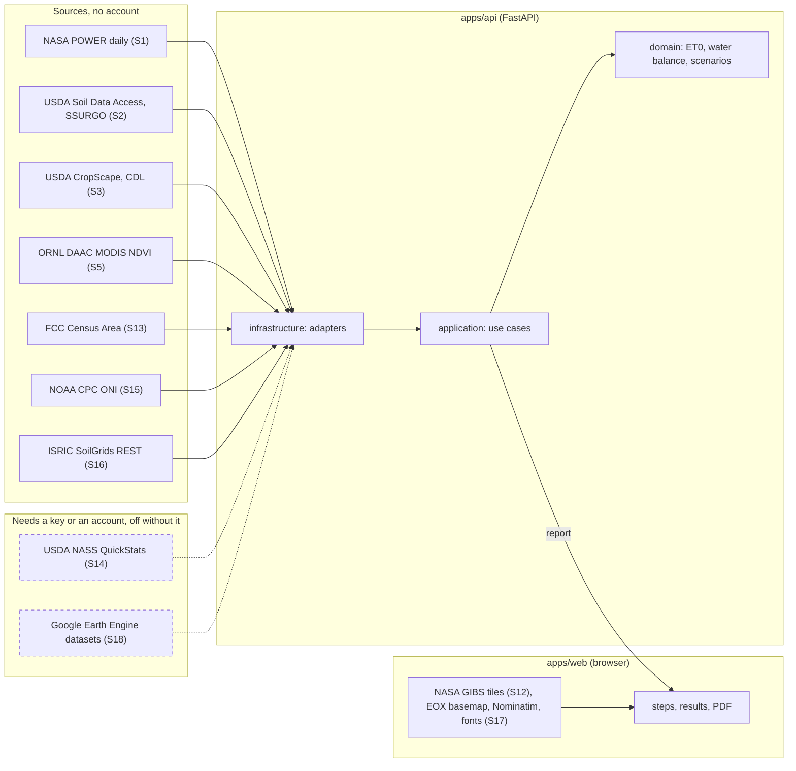

<!-- SI-assisted (Claude Code); reviewed by <name> -->
# Data sources, APIs and connections

The register of every data source, API and account behind Field Shift. It is the file issue [#16](https://github.com/RikepilB/Data_corn/issues/16) asks for. Citations and licences live in [REFERENCES](REFERENCES.md); account and offer status in [ACCOUNTS](setup/ACCOUNTS.md); the system design in [ARCHITECTURE](architecture/ARCHITECTURE.md). Index of all planning documents: [planning README](planning/README.md).

## 1. How to read this register

- **Status words.** *Verified* means a request was made on the stated date and returned the stated result. *To verify* means nobody has checked it against the source yet. *Not used* means no plan task uses it.
- **A probe proves what one response contained on one day.** The probes of 2026-11-14 showed that three services answer. [`scripts/probe_sources.py`](../scripts/probe_sources.py) repeats them and adds counts, dates and product names (log in section 7, run of 2026-11-15). It does not show that another field is as complete as the pilot point.
- **Tier** is Must, Should, Could, Fallback or Not used, as in the cut lines of the [MVP](planning/MVP.md).
- **Where a fact comes from.** Endpoints, SQL and request parameters come from the [implementation plan](superpowers/plans/2026-11-14-field-shift-mvp.md) (Tasks 2, 4, 10, 11, 15). Licences come from REFERENCES and are still marked "verify" there.
- **NASA data on the live path.** POWER (with the MERRA-2, SRB and CERES SYN1deg products behind it, section 3) gives the climate, and NASA GIBS (S12) gives the map layers: SMAP L4 root-zone soil moisture, GPM IMERG rain, MODIS heat and vegetation. MODIS NDVI through the ORNL DAAC service (S5) feeds the crop calendar when the service answers. If every Should item is cut, that still meets the rule of at least one NASA dataset.
- **Plan entries and code entries.** S1 to S11 were written on 2026-11-14 for the original plan (a `pipeline/` that reads AppEEARS). The code on `main` is the Data Corn API, which reads other services. On 2026-11-15 S1 to S11 were checked against the code and S12 to S18 were added for what the code calls and the plan did not name. IDs are stable, not ordered by tier.

## 2. Summary

| # | Source | Role in the solution | Tier | NASA data | Account | Status |
|---|---|---|---|---|---|---|
| S1 | NASA POWER daily point API | Climate forcing, ET0, soil wetness, year types | Must | Yes (NASA LaRC) | None | Verified 2026-11-15: 1981-2025 complete; solar radiation missing for 1981-1983 |
| S2 | USDA NRCS SSURGO through Soil Data Access | Soil available water, texture | Must | No | None | Verified 2026-11-15 with the app's own query: TAW 209.5 mm/m at the pilot point |
| S3 | USDA NASS Crop Sequence Boundaries and CDL | Crop history and current rotation | Must | No | None | CDL through CropScape verified 2026-11-15; Crop Sequence Boundaries to verify |
| S4 | SMAP `SPL3SMP_E.006` through AppEEARS | Consistency check of simulated moisture | Should | Yes (NSIDC DAAC) | Earthdata Login | No adapter; product listed in the CMR on 2026-11-15 |
| S5 | MODIS `MOD13Q1.061` NDVI, read through the ORNL DAAC service | NDVI crop calendar and bare windows | Should | Yes (LP DAAC, ORNL DAAC) | None | Adapter wired; the service failed on 2026-11-15 (503 and 502) |
| S6 | SRTM `SRTMGL1_NC.003` through AppEEARS | Slope for the erosion index | Should | Yes (LP DAAC) | Earthdata Login | No adapter; POWER gives the elevation and SSURGO the slope |
| S7 | GRACE and GRACE-FO mascons | Regional water-storage context | Should | Yes (PO.DAAC) | Earthdata Login | Short name verified in the CMR on 2026-11-15; no adapter |
| S8 | OpenET | Field evapotranspiration cross-check | Could | Consortium product (Landsat-based) | API key, or Earth Engine | Earth Engine adapter written, never run; decision at Checkpoint 3 |
| S9 | Microsoft Planetary Computer STAC | NDVI fallback | Fallback | Hosts NASA products | None to read | Root verified 2026-11-14 and 2026-11-15; no adapter |
| S10 | GPM IMERG, HLS, Copernicus Sentinel-2, Google Earth Engine | Map layer (IMERG); Earth Engine adapters (the rest) | Not in the plan | Partly | Varies | IMERG is on the map; the rest is written and never run; open decision for IMERG ([#16](https://github.com/RikepilB/Data_corn/issues/16)) |
| S11 | Meteomatics, GLDAS, ICEN, Earth Engine SoilGrids, ECOSTRESS | None | Not used | No | None | Not used; the ICEN, Earth Engine SoilGrids and ECOSTRESS adapters are stubs |
| S12 | NASA GIBS map tiles | Map layers on the globe and the field map | In the code | Yes (NASA ESDIS) | None | Verified 2026-11-15: a tile of each of the five layers |
| S13 | FCC Census Area API | State and county of a US field | In the code | No | None | Verified 2026-11-15 |
| S14 | USDA NASS QuickStats | County corn-yield history | In the code | No | Free API key | Not probed: no key |
| S15 | NOAA CPC Oceanic Niño Index | ENSO chip on the verdict | In the code | No | None | Verified 2026-11-15: seasons to ASO 2026 |
| S16 | ISRIC SoilGrids REST | Soil outside the US, and the fallback inside it | In the code | No | None | Verified 2026-11-15 |
| S17 | Basemaps, place search and fonts in the browser | Satellite basemap, place search, type | In the code | No | None, or a Google key | EOX and Nominatim verified 2026-11-15 |
| S18 | Google Earth Engine datasets | SMAP L4, NASADEM, HLS, Sentinel-2, MODIS, PRISM, ERA5-Land, CDL, OpenET; NLDAS, TIGER and GAUL stubs | In the code | Partly | Earth Engine account | Written 2026-11-15, never run |

## 3. Sources in detail

### S1. NASA POWER daily point API (Must)

| Field | Value |
|---|---|
| Role | Climate forcing for the soil-water twin. ET0 uses `T2M_MAX`, `T2M_MIN`, `RH2M`, `WS2M` and `ALLSKY_SFC_SW_DWN`. Rain is `PRECTOTCORR`. Year types use April-September rain. The planting window is a simulation (FAO-56 water balance and growing degree days, a planting date every 7 days, one scenario per historical year), not the soil-temperature rule of the plan: the adapter does not request `TSOIL1`. `GWETROOT` and `GWETTOP` (root-zone and surface soil wetness, 0 to 1) feed the soil-moisture series (`PowerSoilWetness`). |
| Product and endpoint | NASA POWER daily API, point query, AG community: `https://power.larc.nasa.gov/api/temporal/daily/point`. Parameters `T2M_MAX,T2M_MIN,PRECTOTCORR,ALLSKY_SFC_SW_DWN,RH2M,WS2M,GWETROOT,GWETTOP`, as in `apps/api/src/datacorn/infrastructure/power.py` (the plan listed `TSOIL1` instead of `GWETROOT`), output JSON. One request for the whole date range of an analysis; the adapter keeps the answer in memory by point and dates. API version: `v2.10.3` (2026-11-15). |
| Access and registration | None. |
| Auth | None. |
| Coverage | Any latitude and longitude. Target record 1981-2025, about 16 400 daily rows. **Verified 2026-11-15** at the pilot point (section 7): 16 436 daily rows, 1981-01-01 to 2025-12-31, for every parameter. `ALLSKY_SFC_SW_DWN` is -999 on 1 095 days, exactly 1981-1983, and starts on 1984-01-01 as the POWER documentation says; the other parameters have no fill values. ET0 replaces the missing radiation with the Hargreaves estimate (FAO-56 chapter 3, `domain/agronomy/et0.py`). Fill value -999 must become NaN, never 0. |
| Licence and citation | NASA open data policy (verify), per REFERENCES. The exact citation text for POWER and its upstream products is to verify. |
| Fallback | The adapter keeps each answer in memory. An HTTP error becomes `DataUnavailable("nasa_power")`. The web's `?mock=1` sample mode needs no API, so the demo does not depend on a live call. |
| Status | Access verified 2026-11-14 at 39.36, -100.44 with the plan's parameter list: HTTP 200, `TSOIL1` in °C and `GWETTOP` between 0 and 1. Coverage, NaN counts and value ranges verified 2026-11-15 for the adapter's list (section 7, [#36](https://github.com/RikepilB/Data_corn/issues/36)): `GWETROOT` 0.33 to 0.54 and `GWETTOP` 0.21 to 0.71 over 1981-2025. |

Example request, as the adapter builds it (Task 2). Use PowerShell or `curl.exe`: Git-Bash `curl` fails TLS against this host on one team machine.

```powershell
curl.exe -s "https://power.larc.nasa.gov/api/temporal/daily/point?parameters=T2M_MAX,T2M_MIN,PRECTOTCORR,ALLSKY_SFC_SW_DWN,RH2M,WS2M,GWETROOT,GWETTOP&community=AG&longitude=-100.44&latitude=39.36&start=20250401&end=20250410&format=JSON"
```

Expected: HTTP 200, `GWETROOT` and `GWETTOP` unitless between 0 and 1 (2026-11-15; the 2026-11-14 probe asked for `TSOIL1` in °C instead). `python scripts/probe_sources.py power` runs the full-range request and counts the fill values.

**What feeds POWER.** Issue [#16](https://github.com/RikepilB/Data_corn/issues/16) asks us to say which NASA products sit behind POWER, so that the claim "NASA data central to the solution" is exact. The table is from a web-search summary of the POWER data-sources page, [power.larc.nasa.gov/docs/methodology/data/sources](https://power.larc.nasa.gov/docs/methodology/data/sources/), read on 2026-11-14. The page itself was not opened, so everything in it is **to verify**. The API's own header on 2026-11-15 agrees with the table: it names the sources `MERRA2`, `SRB`, `SYN1DEG` and `POWER` and calls the product "NASA/POWER Source Native Resolution Daily Data" (API v2.10.3). It returns `PRECTOTCORR` as "Precipitation Corrected" (mm/day), `GWETROOT` as "Root Zone Soil Wetness", `GWETTOP` as "Surface Soil Wetness" and `TSOIL1` as "Soil Temperatures Layer 1" (°C).

| POWER parameters | Upstream source | Period | Native grid |
|---|---|---|---|
| `T2M_MAX`, `T2M_MIN`, `RH2M`, `WS2M` | GMAO MERRA-2, a reanalysis (a model that assimilates many observations) and not a single mission. GEOS-IT is appended to the end of the daily series for low latency. | From 1981-01-01 | 1/2 degree latitude by 5/8 degree longitude |
| `GWETROOT`, `GWETTOP` | MERRA-2 soil wetness of the root zone and the surface layer; the adapter labels the series `NASA POWER GWETROOT (MERRA-2)`. `TSOIL1`, the MERRA-2 top-layer temperature named in [ARCHITECTURE](architecture/ARCHITECTURE.md), is probed but not requested | To verify | About 0.5 degrees (to verify) |
| `ALLSKY_SFC_SW_DWN` | NASA SRB Release 4 Integrated Product (1984-01-01 to 2000-12-31), then CERES SYN1deg from 2001, with FLASHFlux for the most recent period | From 1984-01-01 | 1 degree by 1 degree |
| `PRECTOTCORR` | **Not confirmed.** The summary did not mention it. Check the POWER parameter dictionary. It matters because the dry, normal and wet split depends on it. The API labels it "Precipitation Corrected" and lists `MERRA2` among its sources (2026-11-15), but the documentation page has not been read. | To verify | To verify |

[ARCHITECTURE](architecture/ARCHITECTURE.md) labels POWER as about 0.5 degrees. If the solar grid is 1 degree, the ficha's `provenance.inputs[].resolution` should name both grids.

### S2. USDA NRCS SSURGO through Soil Data Access (Must)

| Field | Value |
|---|---|
| Role | Soil at the field point: total available water (TAW, mm of water per m of soil) for the twin, and sand, clay and organic matter of the top horizon for `site.soil` in the ficha. The same row gives the mean slope (`slopegradwta`) to `SsurgoPowerTerrain`. |
| Product and endpoint | USDA NRCS Soil Data Access, tabular service: `https://SDMDataAccess.sc.egov.usda.gov/Tabular/post.rest`. The adapter (`infrastructure/ssurgo.py`) posts a JSON body `{"query": <POINT_QUERY>, "format": "JSON+COLUMNNAME"}` with the HTTP client's `post()`. `POINT_QUERY` is one `SELECT TOP 1` row: the map unit at the point (`mapunit`) joined to its aggregated attributes (`muaggatt`: `aws0150wta`, `slopegradwta`) and to its major components (`component`, `majcompflag = 'Yes'`), ordered by `comppct_r` descending, so the row is the **dominant major component**. The texture comes from that component's **top horizon only** (`chorizon` with `hzdept_r = 0`: `sandtotal_r`, `claytotal_r`, `om_r`), left-joined. The row is cached per point. The SSURGO survey version is not read (to verify). |
| TAW | `aws0150wta` is the area-weighted available water in the top 150 cm of the map unit, in cm. TAW = `aws0150wta` × 10 / 1.5 mm/m. Only when `aws0150wta` is null does the adapter use the texture pedotransfer (Saxton and Rawls 2006) from the top horizon's sand, clay and organic matter. With neither, it raises `DataUnavailable`. No point returns no row: outside coverage, also `DataUnavailable`. |
| Access and registration | None. |
| Auth | None. |
| Coverage | The pilot point is covered. **Verified 2026-11-15** (section 7) with the app's own query: Keith silt loam, 1 to 3 percent slopes, south; dominant component 98 percent; `aws0150wta` 31.42 cm, so TAW 209.5 mm/m; top horizon sand 22 percent, clay 22 percent, organic matter 2.6 percent; slope 2.0 percent. Other points are not checked. |
| Licence and citation | Public domain, U.S. Government work (verify), per REFERENCES. |
| Fallback | Cache the response. If the service is slow or down, the region profile uses SoilGrids REST (S16); the texture pedotransfer applies only when `aws0150wta` is null. |
| Status | Verified 2026-11-15 with the app's `POINT_QUERY` at 39.36, -100.44 (`python scripts/probe_sources.py ssurgo`). The earlier probe of 2026-11-14 and the first run of 2026-11-15 used a different, horizon-level query that the app does not run; it stays in the probe only as a completeness cross-check (section 7, [#38](https://github.com/RikepilB/Data_corn/issues/38)). |

The query the app runs, at the probe point (sketch for a Windows machine; `scripts/probe_sources.py` holds the same SQL, marked to keep in sync with `POINT_QUERY`):

```powershell
$sql = "SELECT TOP 1 mu.muname, ma.aws0150wta, ma.slopegradwta, c.comppct_r, c.hydgrp, c.drainagecl, " +
       "h.sandtotal_r, h.claytotal_r, h.om_r " +
       "FROM mapunit mu " +
       "INNER JOIN muaggatt ma ON ma.mukey = mu.mukey " +
       "INNER JOIN component c ON c.mukey = mu.mukey AND c.majcompflag = 'Yes' " +
       "LEFT JOIN chorizon h ON h.cokey = c.cokey AND h.hzdept_r = 0 " +
       "WHERE mu.mukey IN (SELECT * FROM SDA_Get_Mukey_from_intersection_with_WktWgs84('point(-100.440000 39.360000)')) " +
       "ORDER BY c.comppct_r DESC"
$body = @{ query = $sql; format = "JSON+COLUMNNAME" } | ConvertTo-Json
Invoke-RestMethod -Method Post -Uri "https://SDMDataAccess.sc.egov.usda.gov/Tabular/post.rest" -ContentType "application/json" -Body $body
```

### S3. USDA NASS Crop Sequence Boundaries and CDL (Must)

| Field | Value |
|---|---|
| Role | The current rotation of the pilot field, read once by hand ([#19](https://github.com/RikepilB/Data_corn/issues/19)). It sets the `is_current` rotation and, without NDVI, the assumed calendar. The API reads the crop of each year from the CDL through CropScape for the crop history (`infrastructure/cropscape.py`); the Crop Sequence Boundaries stay a manual read. |
| Product and endpoint | Crop Sequence Boundaries (USDA NASS and ERS): field-like polygons with several years of crop history derived from the Cropland Data Layer. The research note says 8 years per polygon, released in 2023. The release and years to use are to verify. Page: [nass.usda.gov, Crop Sequence Boundaries](https://www.nass.usda.gov/Research_and_Science/Crop-Sequence-Boundaries/). CropScape serves single years: `https://nassgeodata.gmu.edu/axis2/services/CDLService/GetCDLValue?year=<Y>&x=<x>&y=<y>`, with x and y in EPSG:5070 metres (the adapter converts longitude and latitude). No key. One request per year. |
| Access and registration | Public download from NASS. No account (to verify). CropScape needs none (verified 2026-11-15). |
| Auth | None (to verify). |
| Example | Manual, once: find the polygon at the pilot point, copy its crop sequence and years, and cite the release. |
| Coverage | US cropland. At the pilot point CropScape answers value 121, "Developed/Open Space", for 2023 and 2024 (verified 2026-11-15): the point is not a cropped pixel. The field polygon chosen in [#19](https://github.com/RikepilB/Data_corn/issues/19) decides. |
| Licence and citation | Public domain, provided "as is" (verify), per REFERENCES. |
| Fallback | Ask a mentor or extension contact ([#27](https://github.com/RikepilB/Data_corn/issues/27)). Otherwise use the team plan's proposed current rotation (continuous corn with irrigation), labelled `assumed`. |
| Status | CropScape verified 2026-11-15 (HTTP 200 for 2023 and 2024, section 7), and the live API run of the same day returned crop history from it. Crop Sequence Boundaries: to verify. |

### S4. SMAP `SPL3SMP_E.006` through AppEEARS (Should)

| Field | Value |
|---|---|
| Role | A consistency check of simulated rainfed soil-moisture anomalies against SMAP at the 9 km pixel, 2015-2025, for the current rotation only. It never validates the alternatives. |
| Product and endpoint | SMAP Enhanced L3 radiometer soil moisture `SPL3SMP_E`, version 006 (`SPL3SMP_E.006`), 9 km, NSIDC DAAC. Layers: AM soil moisture and its retrieval QA. The layer name used in the plan's test is `Soil_Moisture_Retrieval_Data_AM_soil_moisture`; confirm it in the real CSV. Requested through AppEEARS: [appeears.earthdatacloud.nasa.gov](https://appeears.earthdatacloud.nasa.gov). |
| Access and registration | A NASA Earthdata Login (free, one per person) and authorising the NSIDC application. |
| Auth | Earthdata Login. AppEEARS uses the same login. |
| Example | One AppEEARS point sample at the pilot site, CSV output, 2015-04-01 to 2025-12-31, with these layers: `SPL3SMP_E.006` AM soil moisture and its retrieval QA; `MOD13Q1.061` NDVI and pixel reliability; `SRTMGL1_NC.003` elevation. Not a script: it is submitted in the AppEEARS interface ([#18](https://github.com/RikepilB/Data_corn/issues/18)). |
| Coverage | From 2015. SMAP L3 senses about the top 0 to 5 cm, so anomalies are compared, never absolute values. The 9 km pixel in western Kansas mixes center pivots and dryland, and the ficha's validation note says so. The check needs at least 24 valid months, otherwise `not-available`. |
| Licence and citation | NASA open data policy (verify), per REFERENCES. |
| Fallback | `validation.status` is `not-available` and cell confidence is capped at medium. Mentor question 6 asks whether to use the L4 product `SPL4SMGP` instead. |
| Status | **First output received 2026-11-15** (request `datacorn_sheridan_ks`, ID `b0c5dff3-3c90-4515-95f0-1e21dd55a476`, one point at 39.36, -100.44, 2015-04-01 to 2025-12-31, CSV). Layers: `Soil_Moisture_Retrieval_Data_AM_soil_moisture` (the layer named in the plan, confirmed) and `Soil_Moisture_Retrieval_Data_AM_retrieval_qual_flag_scav`. 3,844 daily rows. Fill value `-9999` on 2,108 days, always with quality code 7 (retrieval skipped). 1,736 days carry a value: 1,674 with quality code 0 (recommended) and 62 with code 1 (value present, not recommended). Valid values 0.034 to 0.378, median 0.141. **Valid months: 129 of 129** have at least one valid day, 128 if only quality 0 counts, 124 with 5 or more days, 112 with 10 or more, so the 24-month minimum is met. One 9 km pixel (EASE-Grid tile `h00v00`, line 296, sample 852). Still to do: the consistency check itself, and whether to keep quality 1 days (an open choice, nobody has made it). Raw CSVs stay in `data/raw/appeears/` (gitignored); `request.json` in the AppEEARS zip carries the requester's email and must not be committed. To verify. As of Saturday afternoon, 2026-11-14, Earthdata Login is not set up and the request is not submitted ([#17](https://github.com/RikepilB/Data_corn/issues/17), [#18](https://github.com/RikepilB/Data_corn/issues/18)). No adapter on `main` calls AppEEARS. The map shows SMAP L4 through GIBS (S12), and an Earth Engine adapter for SMAP L4 is written and never run (S18). The CMR lists `SPL3SMP_E` version 006 (NSIDC, 2015-03-31 to ongoing) on 2026-11-15. |

### S5. MODIS `MOD13Q1.061` NDVI, read through the ORNL DAAC service (Should)

| Field | Value |
|---|---|
| Role | An NDVI series at the field point to detect planting, peak and harvest and the bare windows between seasons. |
| Product and endpoint | MODIS Vegetation Indices, 16-day, `MOD13Q1` version 061, 250 m, LP DAAC. The adapter `ornl_modis.py` reads the band `250m_16_days_NDVI` for one point from the ORNL DAAC MODIS web service, `https://modis.ornl.gov/rst/api/v1/MOD13Q1/subset`: May to July of each year, scale 0.0001, values below -2000 dropped. It does not read the pixel reliability layer. AppEEARS is not called. |
| Access and registration | None. |
| Auth | None. |
| Coverage | From 2000 (per REFERENCES). 16-day composites, with gaps where clouds or snow block the view. A gap longer than 48 days never creates a season (Task 11). |
| Licence and citation | NASA open data policy (verify), per REFERENCES. |
| Fallback | NDVI from the Planetary Computer STAC (S9), or `calendar.status = assumed` from the site config. |
| Status | **Also in the first AppEEARS output, 2026-11-15** (same request as S4): `MOD13Q1_061__250m_16_days_NDVI` and `..._pixel_reliability`, 248 composites from 2015-03-22 to 2025-12-19, one pixel (tile `h10v05`, line 307, sample 1124), no fill values. NDVI -0.004 to 0.555, median 0.302. Pixel reliability: 229 good (0), 10 marginal (1), 2 snow or ice (2), 7 cloudy (3). The yearly peak is only 0.40 to 0.55 (2022 lowest), and in 2019 and 2025 it falls in late August and September. That is low for corn, which suggests this 250 m pixel mixes dryland or grass and does not represent a corn field: a hypothesis, not checked against the polygon. This is a second route to NDVI next to the ORNL service, not yet read by any adapter. Probed 2026-11-15 with the app's request (one point, May to July 2025): three requests for six composites returned HTTP 502 after about 61 s, and one request for one composite returned HTTP 503 after 15 s. The adapter treats an HTTP error as no observations and allows 60 s per request. Re-run `python scripts/probe_sources.py modis` until it answers. The CMR lists `MOD13Q1` version 061 (LP DAAC, from 2000-02-18, ongoing). |

### S6. SRTM `SRTMGL1_NC.003` through AppEEARS (Should)

| Field | Value |
|---|---|
| Role | Slope for the relative erosion index. Elevation is also needed for ET0 on the Must path: see the gaps in section 4. |
| Product and endpoint | SRTM, `SRTMGL1_NC.003`, 30 m, LP DAAC, in the same AppEEARS request as S4. REFERENCES lists it as `SRTMGL1` version 003; the plan and the issues use `SRTMGL1_NC.003`. The two names are to reconcile. |
| Access and registration | Earthdata Login. |
| Auth | Earthdata Login. |
| Coverage | 30 m. That the pilot point lies inside the product is to verify. |
| Licence and citation | NASA open data policy (verify), per REFERENCES. |
| Fallback | The SSURGO slope-class midpoint, or the plan's defaults of slope 2% (Keith, 1 to 3%) and K-factor 0.03, with an information gap that names the default (Task 9). |
| Status | **Also in the first AppEEARS output, 2026-11-15** (same request as S4): layer `SRTMGL1_DEM`, tile `N39W101`, **828 m** at 39.36, -100.44 (one row, dated 2000-02-11), with the `SRTMGL1_NUM` layer. POWER gives 866.83 m for the pilot point on the same day, 39 m higher, which is expected if POWER averages a grid cell and SRTM reads 30 m; confirm both are the same point before choosing one for ET0. The slope layer was not requested. No adapter on `main` calls AppEEARS. Elevation comes from POWER (866.83 m at the pilot point, 2026-11-15) and, in the US, the slope from SSURGO; NASADEM through Earth Engine is written and never run (S18). The CMR lists `SRTMGL1_NC` version 003 (LP DAAC, 2000-02-11 to 2000-02-21) on 2026-11-15. |

### S7. GRACE and GRACE-FO mascons (Should)

| Field | Value |
|---|---|
| Role | The regional water-storage trend, as context for the story: why water matters here. About 300 km wide, so it never speaks about one field or one well. |
| Product and endpoint | JPL GRACE and GRACE-FO mascon grid, PO.DAAC: monthly total water storage anomaly as liquid water equivalent thickness (`lwe_thickness`, cm), from 2002. The plan assumes the short name `TELLUS_GRAC-GRFO_MASCON_CRI_GRID_RL06.3_V4`. **Verified in the NASA CMR on 2026-11-15** (version label `RL06.3Mv04`, PO.DAAC cloud, 2002-04-04 to ongoing). |
| Access and registration | Earthdata Login (authorise PO.DAAC). Read through the `earthaccess` library, an optional extra of the pipeline. |
| Auth | Earthdata Login. |
| Coverage | Monthly from 2002. The gap between the two missions (2017-07 to 2018-05) is never interpolated. Footprint about 300 km. |
| Licence and citation | NASA open data policy (verify), per REFERENCES. |
| Fallback | No `water_context` block, and the web shows nothing. Go or no-go is decided by Checkpoint 3. |
| Status | Short name verified in the CMR on 2026-11-15 ([#20](https://github.com/RikepilB/Data_corn/issues/20)). No adapter on `main`. |

### S8. OpenET (Could)

| Field | Value |
|---|---|
| Role | Field evapotranspiration, as an ET cross-check only. The research note says the 2024 global winner combined SMAP and OpenET for planting windows. |
| Product and endpoint | OpenET ensemble, 30 m, Landsat-based (per REFERENCES). API version: to verify. |
| Access and registration | A free account and an API key, requested only if the Must and Should items are green by Checkpoint 3. |
| Auth | API key, kept out of the repo and never committed. |
| Coverage | The research note says it is used in Kansas (to verify). |
| Licence and citation | To verify. |
| Fallback | Drop it. |
| Status | To verify. The decision "use or drop" is due at Checkpoint 3 ([#21](https://github.com/RikepilB/Data_corn/issues/21)). An Earth Engine adapter for the ensemble asset is written and has never run (S18). |

### S9. Microsoft Planetary Computer STAC (Fallback)

| Field | Value |
|---|---|
| Role | A no-account fallback for NDVI if the AppEEARS queue stalls (lane D), and a possible source of imagery collections. |
| Product and endpoint | STAC API: `https://planetarycomputer.microsoft.com/api/stac/v1`. The catalogue includes Sentinel-2 L2A, Landsat and MODIS (per ACCOUNTS). The collection to use for NDVI is to verify. |
| Access and registration | None to read the catalogue. Whether downloading assets needs signed URLs is to verify. |
| Auth | None to read. |
| Coverage | Per collection (to verify). |
| Licence and citation | Per collection (to verify). |
| Fallback | If it also fails, the calendar is `assumed`. |
| Status | Catalogue root verified 2026-11-14 and 2026-11-15 (`GET /api/stac/v1` returned 200). Collections and asset access to verify. No adapter uses it. |

Probe, as run on 2026-11-14 (PowerShell):

```powershell
curl.exe -s -o NUL -w "%{http_code}" https://planetarycomputer.microsoft.com/api/stac/v1
```

### S10. Listed in the team documents, but no plan task uses them

| Source | Where it appears | What is open |
|---|---|---|
| GPM IMERG Final daily, `GPM_3IMERGDF` V07 (GES DISC) | REFERENCES ("planned": rainfall cross-check, erosivity); the demo-slide draft in the [team action plan](TEAM-ACTION-PLAN.es.md) | GIBS shows `IMERG_Precipitation_Rate` as the rain layer of the map (S12), so IMERG is on screen. It is not a model input: the Earth Engine rain adapter (`PowerImergClimate`) is in no region profile. The CMR lists `GPM_3IMERGDF` version 07 (GES DISC, 1998-01-01 to 2025-09-30) on 2026-11-15. Open for the team ([#16](https://github.com/RikepilB/Data_corn/issues/16)): name IMERG on the slide only as a map layer. |
| HLS, `HLSL30` and `HLSS30` version 2.0 (LP DAAC) | REFERENCES; the region profiles | In the code as the first vegetation adapter of the US and global profiles (`hls_sentinel2`, Earth Engine). It runs only with Earth Engine on and has never run (S18). The CMR lists both products (LP DAAC, from 2013-04-11 and 2015-11-28, ongoing) on 2026-11-15. |
| Copernicus Sentinel-2 L2A (ESA) and Copernicus Data Space | REFERENCES; the slide draft; optional offers in [#15](https://github.com/RikepilB/Data_corn/issues/15) | In the code for the in-field zones (Earth Engine, S18) and, as EOX's cloudless mosaic, for the satellite basemap (S17). |
| Google Earth Engine (noncommercial) | Optional offers in [#15](https://github.com/RikepilB/Data_corn/issues/15) | In the code, off by default (`DATACORN_EARTH_ENGINE_ENABLED`); see S18. Registration review can take time. Planetary Computer is the no-wait fallback. |

### S11. Not used

SoilGrids (S16) and the Oceanic Niño Index (S15) were listed here after the pivot. The code uses both, so they moved out on 2026-11-15.

| Source | Why it is not used |
|---|---|
| ISRIC SoilGrids through Earth Engine (`projects/soilgrids-isric/sand_mean`, `clay_mean`, `soc_mean`) | The adapter `earthengine/soilgrids.py` (`SoilGridsSoil`) is registered as `soilgrids` but its `profile()` raises `NotImplementedError`, and no region profile lists it. Soil outside the US comes from the REST service (S16). Not probed |
| ECOSTRESS evapotranspiration (70 m) | The adapter `infrastructure/ecostress.py` is a stub (`NotImplementedError`) registered as `ecostress` and in no region profile; it is not called. Its comment says the product is not in the Earth Engine catalogue and would be read through AppEEARS, which needs an Earthdata account (see section 6). Not probed |
| Índice Costero El Niño (ENFEN and IGP) | The adapter `enso/enfen_icen.py` is a stub (`NotImplementedError`) and the Peru profile lists it before ONI. Not probed |
| Meteomatics weather API | An optional sign-up of the global offers. Not on the Must path and not used. |
| GLDAS | Named in ACCOUNTS as an Earthdata use, but no task uses it |

### S12. NASA GIBS map tiles (in the code)

| Field | Value |
|---|---|
| Role | The map layers on the globe and the field map: root-zone soil moisture, rain, heat and vegetation, and the Blue Marble image of the globe. The browser fetches the tiles; the API is not involved and no number of the report comes from them. |
| Product and endpoint | GIBS WMTS, REST form: `https://gibs.earthdata.nasa.gov/wmts/epsg3857/best/<layer>/default/<date>/<matrix set>/{z}/{y}/{x}.<png or jpeg>`. Layers: `BlueMarble_ShadedRelief_Bathymetry` (2004-08-01), `SMAP_L4_Analyzed_Root_Zone_Soil_Moisture` (daily), `IMERG_Precipitation_Rate` (daily), `MODIS_Terra_L3_Land_Surface_Temp_Monthly_Day` (monthly), `MODIS_Terra_L3_NDVI_Monthly` (monthly). The list and the date ranges are in `apps/web/src/infrastructure/gibs.ts`. |
| Access and registration | None. |
| Coverage | Global. Date ranges per layer in `gibs.ts`. |
| Licence and citation | NASA open data policy (verify), per REFERENCES. The map credits "NASA GIBS". |
| Fallback | Context only: the report does not depend on the tiles. |
| Status | Verified 2026-11-15: one tile of each of the five layers over the pilot point, HTTP 200, `image/png` (`image/jpeg` for the Blue Marble). |

### S13. FCC Census Area API (in the code)

| Field | Value |
|---|---|
| Role | The state and county of a field in the US (`AdminArea`), and whether a point is in the US (`FccCountryLocator`), used to pick the region profile. |
| Product and endpoint | `https://geo.fcc.gov/api/census/area?lat=<lat>&lon=<lon>&censusYear=2020&format=json` (`infrastructure/fcc.py`). |
| Access and registration | None. |
| Coverage | The US. |
| Licence and citation | U.S. Government work (verify), per REFERENCES. |
| Fallback | Not documented in the code; to check. |
| Status | Verified 2026-11-15: state KS, county Sheridan County at the pilot point. |

### S14. USDA NASS QuickStats (in the code)

| Field | Value |
|---|---|
| Role | County corn-yield history, shown as context (`county_yields` in the `describe` answer). |
| Product and endpoint | `https://quickstats.nass.usda.gov/api/api_GET/` (`infrastructure/nass.py`). |
| Access and registration | A free API key from NASS, set as `DATACORN_NASS_API_KEY` in the API's environment. |
| Coverage | US counties. |
| Licence and citation | Public domain, U.S. Government work (verify), per REFERENCES. |
| Fallback | Without a key the source is skipped (comment in the US region profile); the rest of the answer does not depend on it. |
| Status | Not probed: this session has no key. |

### S15. NOAA CPC Oceanic Niño Index (in the code)

| Field | Value |
|---|---|
| Role | The ENSO phase chip on the verdict: the background of the season, not a forecast. |
| Product and endpoint | `https://www.cpc.ncep.noaa.gov/data/indices/oni.ascii.txt`, four columns: season, year, total, anomaly (`infrastructure/enso/noaa_oni.py`). |
| Access and registration | None. |
| Coverage | One global index, seasons from DJF 1950. |
| Licence and citation | U.S. Government work, per REFERENCES. |
| Fallback | A failed download raises `DataUnavailable("noaa_oni")`. |
| Status | Verified 2026-11-15: 921 seasons, DJF 1950 to ASO 2026, last anomaly +2.5. |

### S16. ISRIC SoilGrids REST (in the code)

| Field | Value |
|---|---|
| Role | Sand, clay and soil organic carbon for fields outside the US (Argentina, Brazil, Peru and the global profile), and the fallback after SSURGO in the US. |
| Product and endpoint | `https://rest.isric.org/soilgrids/v2.0/properties/query` with `property=sand,clay,soc`, depths 0-5, 5-15 and 15-30 cm and `value=mean` (`infrastructure/soilgrids_rest.py`). The Earth Engine adapter for the same product is a stub that raises `NotImplementedError` and is in no region profile (S11). |
| Access and registration | None. |
| Coverage | Global; the request reads the three upper layers, 0 to 30 cm. |
| Licence and citation | CC BY 4.0, per REFERENCES. |
| Fallback | Not documented in the code; to check. |
| Status | Verified 2026-11-15: HTTP 200 in 4 s, layers clay, sand and soc. |

### S17. Basemaps, place search and fonts in the browser (in the code)

The browser calls these hosts directly. It sends them tile numbers and a typed place name. The fonts come from the app's own host.

| Host | Use | Access | Status |
|---|---|---|---|
| `tiles.maps.eox.at`, layer `s2cloudless-2024_3857` | Satellite basemap: EOxCloudless 2024 by EOX IT Services GmbH, contains modified Copernicus Sentinel data 2024. The credit is shown on the map | None | Verified 2026-11-15: one tile, HTTP 200, `image/jpeg` |
| `tile.googleapis.com` (Google Map Tiles API, 2D satellite) | A sharper basemap, only when the web build has `PUBLIC_GOOGLE_MAPS_KEY`; the credit line comes from the viewport endpoint | A Google Maps Platform key, restricted by HTTP referrer | Not probed: no key |
| `nominatim.openstreetmap.org` | The place search box: one request per search, five results at most | None. The Nominatim usage policy limits the request rate and asks for a credit line next to the results; the search box shows "© OpenStreetMap contributors" under its results, linked to openstreetmap.org/copyright | Verified 2026-11-15: one result for "Selden Kansas" |
| No fonts host | Atkinson Hyperlegible Next and IBM Plex Mono are self-hosted with the app (Fontsource, OFL-1.1, see REFERENCES.md) | None | No third-party request |

### S18. Google Earth Engine datasets (in the code, never run)

| Field | Value |
|---|---|
| Role | The Earth Engine adapters written on 2026-11-15. Those the US and global region profiles list (PRISM, HLS, SMAP L4, OpenET, CDL, NASADEM) sit next to the no-account sources. They run only with `DATACORN_EARTH_ENGINE_ENABLED` on (default off), and none has run against Earth Engine yet. |
| Datasets | SMAP L4 `NASA/SMAP/SPL4SMGP/008` (root-zone wetness and the drought layer, `GET /api/v1/layers/drought/tiles`); NASADEM `NASA/NASADEM_HGT/001` (elevation, slope, low spots); HLS `NASA/HLS/HLSL30/v002` and `NASA/HLS/HLSS30/v002` (field NDVI at 30 m); Sentinel-2 `COPERNICUS/S2_SR_HARMONIZED` with Cloud Score+ `GOOGLE/CLOUD_SCORE_PLUS/V1/S2_HARMONIZED` (in-field zones); PRISM `OREGONSTATE/PRISM/ANd` (US daily temperature and rain); ERA5-Land `ECMWF/ERA5_LAND/DAILY_AGGR` (global backup climate); USDA CDL `USDA/NASS/CDL` (crop of each year); OpenET ensemble `projects/openet/assets/ensemble/conus/gridmet/monthly/v2_0` (monthly ET); MODIS `MODIS/061/MOD13Q1` (`ModisVegetation`: NDVI at 250 m, written, in no region profile; its in-field zone map raises `DataUnavailable` because 250 m is too coarse). |
| Registered stubs | NLDAS `NASA/NLDAS/FORA0125_H002` (`NldasSoilMoisture`): the adapter always raises `DataUnavailable` because that catalogue product holds forcing fields (rain, temperature, radiation) and no soil moisture. TIGER `TIGER/2018/Counties` (`TigerCounties`), FAO GAUL `FAO/GAUL/2015/level2` (`GaulAdmin`) and the GAUL country locator (`GaulCountryLocator`, level 0): all raise `NotImplementedError`. None is in a region profile; the state and county come from the FCC (S13). SoilGrids and ECOSTRESS stubs are in S11. |
| Access and registration | A Google Cloud project registered for Earth Engine noncommercial use, set as `DATACORN_GCP_PROJECT`. Registration review can take time. |
| Licence and citation | Per dataset, in REFERENCES. |
| Fallback | The region profiles list a no-account adapter after each Earth Engine one (S1, S3, S5; the soil-moisture chain falls back to POWER's wetness, S1). |
| Status | Written 2026-11-15, never run against Earth Engine. Not probed: this session has no account. |

## 4. Gaps in the register

1. **Elevation for ET0.** Closed 2026-11-15. POWER's answer carries the elevation of the point (866.83 m at the pilot point) and the adapter uses it (`PowerTerrain`); in the US SSURGO adds the slope.
2. **`GWETTOP`.** Closed 2026-11-15. It feeds the soil-moisture series together with `GWETROOT` (`PowerSoilWetness`).
3. **`PRECTOTCORR` provenance.** Still open. The API calls it "Precipitation Corrected" (mm/day) and lists `MERRA2` among its sources, but the documentation page has not been read (section 3, S1).
4. **K-factor and slope defaults.** The defaults of 0.03 and 2% come from the plan without a cited source ([#25](https://github.com/RikepilB/Data_corn/issues/25)).
5. **Crop Sequence Boundaries release and years.** To be fixed and cited in [#19](https://github.com/RikepilB/Data_corn/issues/19).
6. **Solar radiation before 1984.** `ALLSKY_SFC_SW_DWN` has no values for 1981-1983 (1 095 days), so ET0 for those three years uses the Hargreaves estimate. Whether the report names this in its information gaps is to check.
7. **The pilot point is not a crop pixel.** CropScape says "Developed/Open Space" at 39.36, -100.44 for 2023 and 2024. The probes use that point only to test the services; the field of [#19](https://github.com/RikepilB/Data_corn/issues/19) decides what the analysis reads.
8. **The ORNL DAAC MODIS service.** It failed on 2026-11-15 (S5). Without NDVI the crop calendar has no observed series. Re-run the probe before the demo.
9. **Documents that still name `TSOIL1`.** The adapter requests `GWETROOT`, not `TSOIL1`, and the planting window is a simulation, so these describe a soil-temperature rule the app does not run: ARCHITECTURE (the diagram and the grid table of section 3, the planting-window rule of section 4), PROBLEM (the proxy caveat), REQUIREMENTS (FR-09 and SC-08, a Must), MVP and TEAM-ACTION-PLAN (the Saturday data checkpoint) and the "NASA Data" draft in SUBMISSION-COMPLIANCE. SC-08 needs a decision first, because the caveat it asks the page to show is about a rule the app does not use. None of these may reach the project form unchanged.

## 5. How the sources connect

Solid arrows are sources the live API reads with no account. Dashed arrows need a key or an account and are off without it. The arrows show the flow of data, not the import direction: `domain/` imports nothing from `application/` or `infrastructure/` (see [ARCHITECTURE](architecture/ARCHITECTURE.md)).



## 6. Accounts and connections

Roles, not names: each person uses their own account and nobody shares a password. Credentials never go in the repository. Offers and their status: [ACCOUNTS](setup/ACCOUNTS.md).

| Connection | Used for | Set up by | Where credentials live | Issue and status |
|---|---|---|---|---|
| GitHub repository [Data_corn](https://github.com/RikepilB/Data_corn) (public) | Code, issues, the "Final Project" link | The repository owner pushes the scaffold and adds collaborators with Write access | Each person's own GitHub login. No shared passwords, no tokens in the repo. | [#11](https://github.com/RikepilB/Data_corn/issues/11), [#12](https://github.com/RikepilB/Data_corn/issues/12). The repository exists with a README and a LICENSE only; the scaffold is not pushed yet. |
| Firebase project `field-shift-datacorn` (Spark plan, no card) | Hosting of the static site. No Auth, no Firestore. | The repository owner, who owns the Google account that created it, logs in with the Firebase CLI and adds teammates as Editors | The Firebase CLI keeps its login on each machine, outside the repo. `.firebaserc` holds only the project ID. | [#14](https://github.com/RikepilB/Data_corn/issues/14). Created on 2026-11-14; nothing is deployed ([#52](https://github.com/RikepilB/Data_corn/issues/52)). |
| NASA Earthdata Login | Not used by the code on `main`: nothing calls AppEEARS or `earthaccess`. The planned SMAP, MODIS and SRTM requests through AppEEARS, and GRACE through `earthaccess`, would need it | Each data person registers their own account and authorises the applications each product needs (NSIDC and GES DISC per the plan, PO.DAAC for GRACE, LP DAAC if AppEEARS asks) | `~/.netrc` on each machine, written by `earthaccess.login(persist=True)`. Never in the repo: `.netrc` and `.env*` are gitignored. | [#17](https://github.com/RikepilB/Data_corn/issues/17). Not set up as of 2026-11-14. |
| AppEEARS | One point request: SMAP, MODIS NDVI, SRTM (not called by the code on `main`) | The person who owns the request, chosen at kickoff (recommended: the lane C data lead), ideally before 14:00 on Saturday | No separate credential: it uses the Earthdata Login. Output CSVs go to `data/raw/appeears/` (gitignored). | [#18](https://github.com/RikepilB/Data_corn/issues/18). Not submitted as of 2026-11-14. |
| OpenET API key | ET cross-check (Could) | Requested only if the Must and Should items are green by Checkpoint 3 | Outside the repo, never committed | [#21](https://github.com/RikepilB/Data_corn/issues/21) |
| Sources with no account | POWER, Soil Data Access, CropScape, FCC, NOAA CPC, the ORNL DAAC MODIS service, SoilGrids REST, GIBS, EOX, Nominatim, Crop Sequence Boundaries (download), Planetary Computer (read), the NASA CMR (product search) | Nobody | None | Probed on 2026-11-14 (POWER, Soil Data Access, Planetary Computer) and 2026-11-15 (the others, section 7) |
| USDA NASS QuickStats key | County corn yields (S14) | Whoever registers at quickstats.nass.usda.gov (free) | `DATACORN_NASS_API_KEY` in the API's environment, never in the repo | Not set up; the source is skipped without it |
| Google Earth Engine | The Earth Engine adapters (S18) | The owner of the Cloud project registered for noncommercial use | `DATACORN_GCP_PROJECT` and `DATACORN_EARTH_ENGINE_ENABLED` in the API's environment; credentials stay outside the repo | Adapters written, never run; off by default |
| Google Map Tiles key | The optional sharper satellite basemap (S17) | The owner of the Cloud project | `PUBLIC_GOOGLE_MAPS_KEY` at web build time: a browser key, restricted by HTTP referrer | Optional; the EOX basemap is used without it |
| Optional offers | Meteomatics (not used), a free domain, Copernicus Data Space, Google Earth Engine | See [ACCOUNTS](setup/ACCOUNTS.md) | Not applicable | [#15](https://github.com/RikepilB/Data_corn/issues/15). None is on the Must path. |

The Google Cloud trial is not available on the owner's account (already used). The static site does not need it. It would matter only for the Could item "live analysis of any field".

## 7. Probe log

| Date | Source | Probe | Result | Not yet checked |
|---|---|---|---|---|
| 2026-11-14 | POWER daily | Point request at 39.36, -100.44 with the plan's 8 parameters (`TSOIL1` and `GWETTOP`, not `GWETROOT`) | HTTP 200. `TSOIL1` in °C, `GWETTOP` between 0 and 1. | Coverage and NaN counts ([#36](https://github.com/RikepilB/Data_corn/issues/36)) |
| 2026-11-14 | Soil Data Access | A horizon-level SQL (the plan's Task 4 draft, not the query the app runs) at the same point | HTTP 200. Keith silt loam, 1 to 3 percent slopes, `awc_r` 0.21. | Not the app's query: see the 2026-11-15 row |
| 2026-11-14 | Planetary Computer | `GET /api/stac/v1` | HTTP 200 | Collections and asset access |
| 2026-11-14 | POWER documentation | One web search restricted to `power.larc.nasa.gov` for the data-sources page. The first attempt, with another search tool, failed because that tool's API key was invalid. | The summary names MERRA-2, SRB Release 4-IP, CERES SYN1deg, FLASHFlux and the grids in section 3. | It is a search summary, not the page. It did not mention `PRECTOTCORR`. Open the page to confirm. |
| 2026-11-15 | POWER daily | `python scripts/probe_sources.py power`: the app's 8 parameters and `TSOIL1`, 1981-01-01 to 2025-12-31 | HTTP 200 in 2 s. API v2.10.3, sources MERRA2, SRB, SYN1DEG, POWER. 16 436 days. `ALLSKY_SFC_SW_DWN` has 1 095 fill values (1981-1983); the other parameters have none. Elevation 866.83 m. Ranges: `T2M_MAX` -18.4 to 46.17 °C, `T2M_MIN` -26.91 to 27.95 °C, `PRECTOTCORR` 0 to 61.19 mm/day, `ALLSKY_SFC_SW_DWN` 0.06 to 32.91 MJ/m²/day, `RH2M` 15.31 to 97.35 %, `WS2M` 0.81 to 11.02 m/s, `GWETROOT` 0.33 to 0.54, `GWETTOP` 0.21 to 0.71, `TSOIL1` -16.03 to 35.3 °C | The documentation page |
| 2026-11-15 | Soil Data Access | `... probe_sources.py ssurgo`: the app's `POINT_QUERY` (copied from `ssurgo.py`) at the pilot point, then the horizon query as a cross-check | HTTP 200 in 1.5 s. App query: Keith silt loam, 1 to 3 percent slopes, south; dominant component 98 percent, hydrologic group C, well drained; `aws0150wta` 31.42 cm, so TAW 209.5 mm/m; slope 2.0 percent; top horizon sand 22, clay 22, organic matter 2.6 percent. Cross-check (not run by the app): Keith (98 percent), 5 horizons to 200 cm, no gaps, `awc_r` in all, depth-weighted TAW 210 mm/m over 150 cm. The two agree within 1 mm/m. A first run earlier the same day used only the horizon query and was logged as the app's result; that was wrong | Other points; the survey version |
| 2026-11-15 | CropScape | `... cropscape`: `GetCDLValue` for 2023 and 2024 | HTTP 200. Value 121, "Developed/Open Space", both years | A cropped point |
| 2026-11-15 | FCC Census Area | `... fcc` | HTTP 200. State KS, Sheridan County | Outside the US |
| 2026-11-15 | NOAA CPC ONI | `... oni` | 921 seasons, DJF 1950 to ASO 2026, last anomaly +2.5 | — |
| 2026-11-15 | ORNL DAAC MODIS | `... modis`: one point, `250m_16_days_NDVI`, May to July 2025 | Six composites: HTTP 502 after about 61 s, three times. One composite: HTTP 503 after 15 s | The data, until the service answers |
| 2026-11-15 | SoilGrids REST | `... soilgrids` | HTTP 200 in 4 s. Layers clay, sand, soc | The values |
| 2026-11-15 | NASA GIBS | `... gibs`: one tile of each of the five layers | HTTP 200 for all; `image/png`, `image/jpeg` for the Blue Marble | The date range of each layer |
| 2026-11-15 | EOX Sentinel-2 cloudless | `... eox` | HTTP 200, `image/jpeg` | EOX terms |
| 2026-11-15 | Nominatim | `... nominatim`: "Selden Kansas" | One result: Selden, Sheridan County, Kansas, 67757 | The usage policy |
| 2026-11-15 | Planetary Computer | `... stac`: `GET /api/stac/v1` | HTTP 200, "Microsoft Planetary Computer STAC API" | Collections and asset access |
| 2026-11-15 | NASA CMR | `... cmr`: collection search by short name, no login | Found: `SPL3SMP_E` 006, `SPL4SMGP` 008, `MOD13Q1` 061, `SRTMGL1_NC` 003, `NASADEM_HGT` 001, `GPM_3IMERGDF` 07, `HLSL30` and `HLSS30` 2.0, `TELLUS_GRAC-GRFO_MASCON_CRI_GRID_RL06.3_V4` (RL06.3Mv04) | — |

## 8. What is left to verify

Issue [#16](https://github.com/RikepilB/Data_corn/issues/16) is done when each Must and Should source has a dated probe result and a REFERENCES row. `python scripts/probe_sources.py` repeats the probes.

- [x] POWER: 1981-2025 coverage and NaN counts ([#36](https://github.com/RikepilB/Data_corn/issues/36)). Done 2026-11-15: complete, except solar radiation for 1981-1983.
- [x] Soil Data Access: horizon completeness to 150 cm ([#38](https://github.com/RikepilB/Data_corn/issues/38)). Done 2026-11-15 at the pilot point.
- [ ] Crop Sequence Boundaries or CDL: the pilot field's rotation read and cited ([#19](https://github.com/RikepilB/Data_corn/issues/19)). CropScape answers; the pilot point is not a crop pixel.
- [ ] Earthdata Login for each data person ([#17](https://github.com/RikepilB/Data_corn/issues/17)). The code on `main` does not need it.
- [ ] AppEEARS: layer names, QA codes, fill values and the count of valid SMAP months ([#18](https://github.com/RikepilB/Data_corn/issues/18)). The code on `main` does not call it.
- [x] GRACE: the product short name ([#20](https://github.com/RikepilB/Data_corn/issues/20)). Verified in the CMR on 2026-11-15.
- [ ] OpenET: use or drop ([#21](https://github.com/RikepilB/Data_corn/issues/21)).
- [ ] IMERG: decide, and update the slide draft ([#16](https://github.com/RikepilB/Data_corn/issues/16)). It is on the map through GIBS; it is not a model input.
- [ ] ORNL DAAC MODIS service: re-run `python scripts/probe_sources.py modis` until it answers.
- [ ] NASS QuickStats and the Earth Engine datasets: probe them with a key and an account.
- [x] A REFERENCES row for every library and every data, tile and font host in the code ([#22](https://github.com/RikepilB/Data_corn/issues/22)). Done 2026-11-15; `python scripts/compliance_audit.py` checks it.
