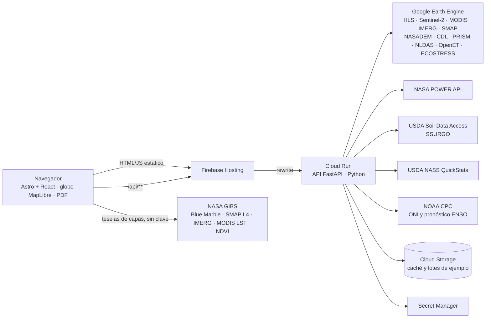
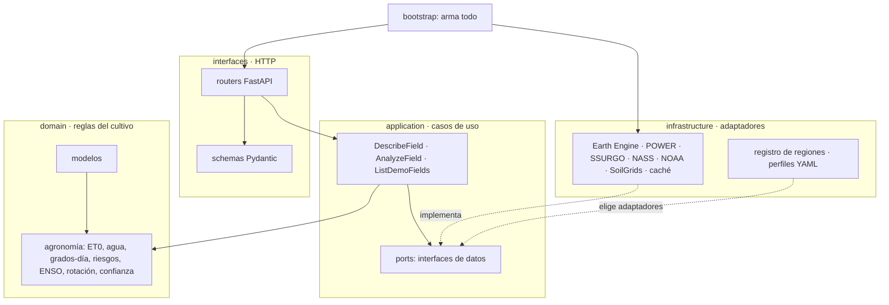

# Data Corn — Arquitectura y contrato de la API

Parte A: cómo está armado el sistema. Parte B: el contrato entre la API y la web. Las dos partes están en un solo archivo porque cambian juntas.

## Parte A · Arquitectura

### A1. Vista general



- **Web:** Astro genera un sitio estático. Las partes interactivas (mapa, formulario, tarjetas) son una isla de React.
- **API:** FastAPI en Cloud Run, región `us-central1`. Arranca en 0 instancias y escala sola.
- **Mismo dominio:** Firebase Hosting reenvía `/api/**` a Cloud Run, así que no hace falta CORS en producción.

### A2. Clean architecture del backend



**Regla de dependencias:** las flechas solo apuntan hacia adentro.
- `domain` no importa nada del proyecto ni de librerías externas de datos.
- `application` solo importa `domain`.
- `infrastructure` implementa los puertos de `application`.
- `interfaces` usa los casos de uso.
- `bootstrap.py` es el único lugar donde se conectan las capas.

| Capa | Carpeta | Qué contiene |
|---|---|---|
| Dominio | `apps/api/src/datacorn/domain/` | Modelos (lote, suelo, clima, etapas, reporte) y cálculos puros: FAO-56, balance de agua, grados-día, calor, helada, riego, NDVI, ENSO, rotación, zonas, confianza |
| Aplicación | `apps/api/src/datacorn/application/` | Puertos (interfaces) y casos de uso |
| Infraestructura | `apps/api/src/datacorn/infrastructure/` | Adaptadores de cada fuente de datos, caché, registro de regiones |
| Interfaces | `apps/api/src/datacorn/interfaces/http/` | API REST, validación y serialización |
| Recursos | `apps/api/src/datacorn/resources/` | Perfiles de región y parámetros de cultivos en YAML |

### A3. Escalar a otros países: perfiles de región

Cada región es un archivo YAML. Para cada variable, el archivo indica qué fuente usar y en qué orden probar los respaldos. Sumar Perú, Brasil o Argentina consiste en escribir su perfil y, si una fuente es nueva, su adaptador. El dominio y la pantalla no cambian.

| Puerto | EE. UU. (activo) | Respaldo global | Perú / Brasil / Argentina (después) |
|---|---|---|---|
| `ClimatePort` | PRISM + POWER | POWER, ERA5-Land, IMERG | POWER, ERA5-Land, IMERG |
| `SoilPort` | SSURGO | SoilGrids | SoilGrids |
| `ElevationPort` | NASADEM | NASADEM | NASADEM |
| `CropHistoryPort` | CDL | — | MapBiomas (por evaluar) |
| `VegetationPort` | HLS, Sentinel-2, MODIS | igual | igual |
| `SoilMoisturePort` | SMAP L4, NLDAS | SMAP L4 | SMAP L4 |
| `EvapotranspirationPort` | OpenET (oeste), ECOSTRESS | ECOSTRESS | ECOSTRESS |
| `EnsoPort` | ONI | ONI | ICEN + ONI (Perú) · ONI |
| `YieldStatsPort` | NASS | — | MIDAGRI · CONAB/IBGE · MAGyP |
| `GroundwaterPort` (después, aún sin código) | NWIS | GRACE | GRACE |

El indicador de El Niño se calcula igual en todas las regiones, agrupando la historia del lote por fase. Si en un lugar la relación es débil, como en el Corn Belt, el sistema lo informa. Donde es fuerte, como en la costa del Perú, se ve en los datos. El sistema no supone el efecto: lo mide.

### A4. Estructura de carpetas

```
Nasa/                               raíz del repositorio
├─ README.md · LICENSE · .gitignore · .editorconfig · firebase.json
├─ docs/                            mapa en docs/README.md (app/, challenge/, planning/, …)
├─ apps/
│  ├─ api/                          backend Python (Cloud Run)
│  │  ├─ pyproject.toml · Dockerfile · .env.example
│  │  ├─ src/datacorn/
│  │  │  ├─ domain/                 models.py · report.py · crops.py · agronomy/*
│  │  │  ├─ application/            ports.py · dto.py · use_cases/*
│  │  │  ├─ infrastructure/         providers.py · earthengine/* (incluye SoilGrids) · power.py · ssurgo.py · nass.py · ecostress.py · enso/ · cache/ · regions/
│  │  │  ├─ interfaces/http/        app.py · routes/* · schemas.py
│  │  │  ├─ resources/              regions/*.yaml · crops/*.yaml
│  │  │  ├─ bootstrap.py · config.py · main.py
│  │  └─ tests/                     unit/ · integration/
│  └─ web/                          frontend Astro + React
│     ├─ package.json · astro.config.mjs · tsconfig.json
│     └─ src/
│        ├─ pages/ · layouts/       index.astro (pantalla única)
│        ├─ app/                    DataCornApp.tsx (isla principal)
│        ├─ domain/                 tipos del reporte · conversión de unidades
│        ├─ application/            estado y casos de uso de la web
│        ├─ infrastructure/         cliente de la API · configuración del mapa
│        ├─ ui/                     map (globo, vuelo, dibujo, capas) · steps · film · stripes · cards · pdf · common
│        ├─ i18n/                   es.json · en.json
│        └─ styles/
└─ infra/                           despliegue: Cloud Run, Firebase, presupuesto
```

### A5. Decisiones técnicas

| Tema | Decisión | Motivo |
|---|---|---|
| Backend | Python 3.12 + FastAPI 0.163 | La API de Earth Engine para Python es la más completa, y numpy y scipy cubren FAO-56 y el suavizado del NDVI |
| Frontend | Astro 7.4 + React 19 + TypeScript 6 | Astro lo eligió el equipo. React tiene más ejemplos de mapas y dibujo. TypeScript 6 porque `@astrojs/check` aún no admite TypeScript 7 |
| Requisito de Node | 22.23.4 o superior | Lo exige Astro 7.4 |
| Mapa | MapLibre GL 6 con proyección de globo, `flyTo` para el vuelo, y Terra Draw para dibujar con puntos | Libres y sin clave; el globo 3D viene incluido |
| Fondo del mapa | Blue Marble de NASA GIBS en el globo; Sentinel-2 cloudless de EOX al acercarse | No piden clave. Se puede cambiar a Google Map Tiles por configuración |
| Capas de clima | Desde NASA GIBS, directo del navegador: `SMAP_L4_Analyzed_Root_Zone_Soil_Moisture`, `IMERG_Precipitation_Rate`, `MODIS_Terra_L3_Land_Surface_Temp_Daily_Day`, `MODIS_Terra_L3_NDVI_Monthly`. La sequía (anomalía) se calcula en Earth Engine | GIBS es de la NASA, gratis y con dimensión de tiempo. La anomalía necesita comparar con la normal, por eso va en Earth Engine |
| PDF | `@react-pdf/renderer` 4.9, en el navegador | Reutiliza los textos (es/en), las unidades y el reporte ya cargado. No cuesta servidor |
| Gráficos | Recharts 3 | Se integra con React y tiene texto alternativo |
| Hosting | Firebase Hosting + Cloud Run `us-central1` | Todo dentro del crédito de Google Cloud; Earth Engine está en la misma región |
| Caché | Cloud Storage, JSON por clave (contorno + datos) | Barato y suficiente para el hackathon |
| Unidades internas | Métricas | Se convierten solo al mostrarlas |
| Licencia | Apache-2.0 | La pide Space Apps por defecto |

### A6. Accesos que faltan

| Qué | Para qué |
|---|---|
| Proyecto nuevo en Google Cloud (crédito de $300) | Cloud Run, Cloud Storage, Secret Manager |
| Registro del proyecto en Earth Engine (uso no comercial) y una cuenta de servicio | Que la API consulte Earth Engine |
| Clave de NASS QuickStats (gratis) | Rendimiento por condado y fechas de siembra |
| Proyecto de Firebase vinculado al de Google Cloud | Publicar la web |
| Repositorio en GitHub | Código abierto, enlace para la entrega |

El estado real de cada cuenta está en [setup/ACCOUNTS.md](../setup/ACCOUNTS.md). Según ese archivo, la prueba de $300 de Google Cloud no está disponible en la cuenta del propietario del repositorio.

## Parte B · Contrato entre la API y la web

Los tipos exactos viven en `apps/api/src/datacorn/domain/report.py` (Python) y en `apps/web/src/domain/report.ts` (TypeScript). Este documento fija lo que los tipos no dicen: claves de texto, parámetros y qué significa cada número.

### B1. Rutas

| Método y ruta | Entrada | Salida | Cuándo la llama la web |
|---|---|---|---|
| `GET /api/v1/health` | — | Estado del servicio | Apoyo |
| `GET /api/v1/regions` | — | Regiones con su estado (activa o planificada) y sus fuentes | Apoyo |
| `GET /api/v1/demo-fields` | — | Lotes de ejemplo | Apoyo |
| `GET /api/v1/layers` | — | Catálogo de capas: id, fuente (GIBS o Earth Engine), leyenda y rango de fechas | — |
| `GET /api/v1/layers/drought/tiles?date=AAAA-MM` | Mes | Plantilla de teselas de Earth Engine con la anomalía de humedad SMAP L4 de ese mes (en caché por unas horas) | — |
| `POST /api/v1/fields/describe` `{geometry, season}` | Contorno GeoJSON y campaña | Contexto del lote (región, condado, área, suelo, relieve, cultivos por año, rendimiento del condado, ENSO actual) y valores por defecto. En la misma llamada descarga el clima y los datos satelitales del lote y los deja en caché. | Al cerrar el lote, en el paso 3 «Calculando». Puede tardar de 10 a 40 s. |
| `POST /api/v1/fields/analyze` `{geometry, season, planting_date, hybrid_rm_days, irrigation, irrigation_capacity_mm_day, tillage, yield_goal_t_ha, previous_crop}` | Contorno, campaña y los datos del formulario | Reporte: veredicto, película de la campaña (serie diaria del año típico, de los años El Niño y de cada año), franjas por año, indicadores, rotación, ENSO, zonas, confianza y fuentes. Usa los datos en caché, así que es inmediato. | Al pulsar «Ver resultados». Tarda menos de 2 s. |

El PDF no pasa por la API: la web lo arma con el mismo reporte.

Errores: `422 invalid_geometry {reason}`, `422 data_unavailable {source, reason}`, `501 not_implemented {detail}`. Mientras una función no esté construida, su ruta responde `501` con el paso que falta (por ejemplo `F4`).

### B2. Unidades, textos y parámetros

- **Unidades:** toda la API trabaja en unidades métricas (mm, °C, ha, t/ha, mm/día). La web convierte a imperiales solo al mostrar.
- **Textos:** la API no devuelve frases armadas. Devuelve claves de texto con sus valores (por ejemplo `flowering_water.high` con `{years: 9, total: 20}`), y la web las traduce con `es.json` o `en.json`. Así el mismo reporte sirve para los dos idiomas.
- **Parámetros de los mensajes:** cada `Message` tiene `key` y `params`. La web da formato a los parámetros según el sufijo de su nombre:

| Sufijo | Se muestra como |
|---|---|
| `_mm` | lámina en mm o in, según las unidades |
| `_c` | temperatura en °C o °F |
| `_date` | fecha corta según el idioma (`2027-04-25` → «25 abr» / «Apr 25») |
| `_pct` | porcentaje entero («12 %») |
| `_indicator` | nombre del indicador traducido (`indicator.<valor>`) |
| `_crop` | cultivo traducido (`crop.<valor>`) |
| `_phase` | fase traducida (`enso.<valor>`) |
| sin sufijo | tal cual |

### B3. Indicadores: número clave y mensajes

| `id` | `value` / `unit` | Claves de mensaje | Parámetros |
|---|---|---|---|
| `planting_window` | `null` | `planting_window.inside` · `.early` · `.late` | `start_date`, `end_date` |
| `hybrid_fit` | años en que madura antes de la helada / `count` | `hybrid_fit.ok` · `.tight` · `.risky` | `years`, `total`, `rm` |
| `frost` | probabilidad de helada tardía, 0-1 / `fraction` | `frost.low` · `.medium` · `.high` | `late_pct`, `early_pct` |
| `flowering_water` | años con estrés en floración / `count` | `flowering_water.low` · `.medium` · `.high` | `years`, `total`, `loss_pct` |
| `flowering_heat` | mediana de días calurosos en floración / `days` | `flowering_heat.low` · `.medium` · `.high` | `days`, `threshold_c` |
| `irrigation` (solo con riego) | lámina de la semana pico / `mm_week` | `irrigation.ok` · `.tight` · `.short` | `peak_week_mm`, `capacity_week_mm`, `season_mm` |
| `season_progress` | desfase en días (+ adelantado, − atrasado) / `days` | `season_progress.ahead` · `.normal` · `.behind` · `.not_started` · `.no_data` | `days`, `season` |
| `waterlogging` | años con encharcamiento / `count` | `waterlogging.low` · `.medium` · `.high` | `years`, `total` |
| `field_zones` | `null` | `field_zones.needs_ee` | — |

Qué revisar en campo (`field_check.key`): `check.soil_probe`, `check.scout_silking`, `check.frost_low_spots`, `check.irrigation_schedule`, `check.drainage`, `check.scout_field`.

### B4. Resumen, rotación y El Niño

- `summary.recommendation`: `summary.good` o `summary.watch`, con los parámetros `start_date`, `end_date` y `main_indicator`.
- `rotation.message`: `rotation.soy_first`, con `pattern` (por ejemplo `"M S M S M"`, del año más viejo al más nuevo), `after_soy` y `after_corn` (años de cada caso en el historial).
- `rotation.options[].notes`: `rotation.note.rootworm` y `rotation.note.residue`.
- `enso.message`: `enso.weak`, `enso.moderate` o `enso.strong`, con `now_phase`, `delta_pct` (diferencia de rendimiento relativo entre la fase actual y los años neutrales) y `years` (años de la historia en esa fase). Con menos de 5 años en la fase siempre sale `enso.weak`, porque no hay evidencia suficiente.
- `rotation.message` también puede ser `rotation.corn_on_slopes`, con los mismos parámetros, cuando el lote tiene mucha pendiente y labranza convencional.

### B5. Película y franjas

- `runs[]` trae una campaña por año análogo, ordenadas por año. Si la campaña ya tiene días observados, `observed_days > 0` en todas: esos primeros días son los reales.
- `typical_year` es el año de la campaña con el rendimiento relativo mediano. Es la que se muestra por defecto.
- **Película:** el día `i` es `start + i`. Para el lote se usan `water_pct[i]` (0-100) y `tmax_c[i]`. Para el mapa de la zona, se usa la misma fecha de ese año en la capa SMAP de GIBS (hay datos desde 2015-03-31).
- **Franjas:** cada `run` es una franja. Su color sale de `relative_yield` (1.0 = azul, ≤ 0.7 = rojo) y lleva una marca si `enso_phase` es `el_nino` o `la_nina`.
- **«Años El Niño»:** en la película es la campaña con el rendimiento relativo mediano entre los años con El Niño.

### B6. Las 6 tarjetas de la pantalla

| # | Tarjeta | Fuente |
|---|---|---|
| 1 | Fecha de siembra · o · Avance del lote | `planting_window`; si la campaña ya empezó y `season_progress` tiene datos, `season_progress` |
| 2 | Agua en floración | `flowering_water` |
| 3 | Calor en floración | `flowering_heat` |
| 4 | Híbrido y helada | `hybrid_fit` (número) + `frost` (en la frase) |
| 5 | Riego · o · Encharcamiento | `irrigation` si el lote tiene riego; si no, `waterlogging` |
| 6 | Rotación | `rotation` |

### B7. Datos sin cuenta (estado actual)

Funciona sin claves, con estas fuentes:
- **Clima, humedad del suelo y altura:** NASA POWER (MERRA-2).
- **Suelo y pendiente:** USDA SSURGO, vía Soil Data Access.
- **Condado:** FCC Census Area API.
- **Cultivo por año:** USDA NASS CropScape (CDL).
- **NDVI:** MODIS MOD13Q1, vía ORNL DAAC.
- **El Niño:** NOAA CPC ONI.
- **Capas del globo:** NASA GIBS.
- **Suelo fuera de EE. UU.:** ISRIC SoilGrids.

Con cuentas se suman Earth Engine (PRISM, HLS/Sentinel-2, SMAP, zonas del lote, sequía) y NASS QuickStats (rendimiento por condado).
