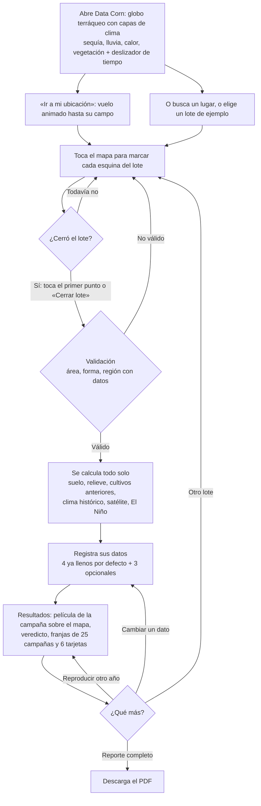
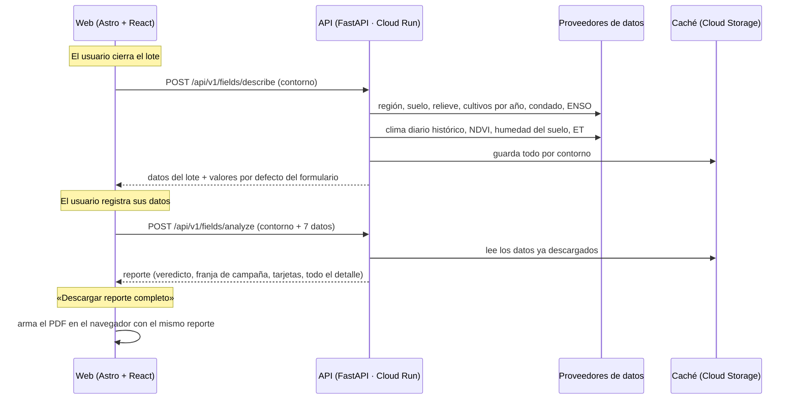

# Data Corn — Flujo y pantalla

La idea es «Google Earth para el maíz». Cuatro reglas:
- **El mapa es la pantalla.** Se empieza con la Tierra vista desde el espacio y se vuela hasta el lote.
- **Un paso a la vez.** Nunca hay más de una cosa que hacer.
- **Ver antes que leer.** El clima y la campaña se ven sobre el mapa, en colores y en movimiento.
- **En pantalla solo lo importante.** El detalle técnico va en el PDF.

Es una sola pantalla, con el mapa siempre de fondo. Está pensada primero para el celular. En escritorio, el panel de resultados va a la derecha del mapa.

El reporte completo se descarga en PDF. No pide login ni registro.

## 1. Flujo del usuario



## 2. Qué pasa detrás

El trabajo pesado se hace al cerrar el lote. Después del formulario solo queda calcular, y eso es inmediato.



## 3. Antes y durante la campaña: un solo cálculo

La campaña siempre se arma con los días ya observados hasta hoy. Los días que faltan se completan con escenarios de los años históricos de ese mismo lote.

| Momento | Días observados | Días con escenarios históricos | Qué ve el usuario |
|---|---|---|---|
| Antes de sembrar | ninguno | toda la campaña | riesgos esperados y la mejor fecha de siembra |
| Durante la campaña | desde la siembra hasta hoy | desde mañana hasta la cosecha | cómo va el lote y qué riesgos le quedan |
| Después de cosechar | toda la campaña | ninguno | repaso: qué pasó y por qué |

Los escenarios se pueden filtrar por fase de El Niño: si hoy hay El Niño, pesan más los años con El Niño.

Al 14 de noviembre de 2026, la demo muestra dos campañas:
- la campaña 2027, todavía antes de sembrar;
- la campaña 2026, ya cosechada, como repaso.

## 4. Pasos de la pantalla

| Paso | Qué se ve | Cómo se sale |
|---|---|---|
| 1. Globo | La Tierra en 3D con capas de clima (sequía, lluvia, calor, vegetación) y un deslizador de tiempo; el botón grande «Ir a mi ubicación»; enlaces para buscar un lugar o ver un ejemplo | Vuelo animado hasta la ubicación |
| 2. Dibujar | La guía «Toque las esquinas de su lote», los puntos y líneas, el área en vivo y los botones «Deshacer» y «Cerrar lote» | Al cerrar el lote |
| 3. Calculando | El lote dibujado y una lista de avance que se va marcando: ubicación, suelo y relieve, cultivos anteriores, clima, satélite | Al terminar (o con error) |
| 4. Sus datos | Panel sobre el mapa con un resumen de lo detectado, 4 datos ya llenos y los opcionales plegados | «Ver resultados» |
| 5. Resultados | El mapa grande con la película de la campaña (▶ día a día), el veredicto, las franjas de 25 campañas, las 6 tarjetas clave, el botón del PDF y los enlaces «Cambiar datos» y «Nuevo lote» | Cambiar datos, nuevo lote o PDF |
| Error | Qué pasó y qué hacer, sin perder el lote dibujado | Reintentar o volver a dibujar |

Errores previstos:
- **Ubicación denegada:** se ofrece buscar el lugar a mano.
- **Contorno inválido:** dice qué corregir (muy chico, muy grande o con lados cruzados).
- **Zona sin datos suficientes:** se calcula con fuentes globales y confianza baja, y se avisa.
- **Servicio caído:** botón para reintentar.

## 5. Cada paso en detalle

Un boceto por paso, con lo que muestra y lo que hace. La tabla de la sección 4 es el resumen.

### Paso 1 · El globo

```
┌────────────────────────────────┐
│ Data Corn          ES|EN  in|mm│  barra mínima, flotante
│ (Sequía)(Lluvia)(Calor)(Veget.)│  capas sobre el globo
│              ✦        ✦        │
│          ╭────────╮            │
│        ╭╯  GLOBO   ╰╮          │  la Tierra en 3D (Blue Marble),
│        │  TERRÁQUEO │          │  con la capa elegida en color
│        ╰╮          ╭╯          │
│          ╰────────╯     ✦      │
│ seco ▇▇▇▇▇▇▇▇▇▇ húmedo          │  leyenda de la capa
│ ▶  ene feb mar abr may jun …   │  deslizador de tiempo
│ ┌────────────────────────────┐ │
│ │  ◎  Ir a mi ubicación      │ │  botón principal
│ └────────────────────────────┘ │
│   Buscar un lugar · Ver ejemplo│
└────────────────────────────────┘
```

- **Antes de ubicarse:** el usuario puede ver cómo se comporta el clima en el mundo. Elige una capa y mueve el tiempo o pulsa ▶.
- **«Ir a mi ubicación»:** el mapa hace un vuelo animado de unos 4 segundos, del globo al continente y luego al campo.
- **Movimiento reducido:** si el usuario lo pide, salta directo sin animación.

### Paso 2 · Dibujar el lote

```
┌────────────────────────────────┐
│  Toque las esquinas de su lote │
│        ●──────────●            │
│        │  132 ac  │            │  área en vivo
│        ●──────────●            │
│ [ ↶ Deshacer ]  [ ✓ Cerrar lote ]│
└────────────────────────────────┘
```

Cada toque agrega un punto, y un punto se mueve arrastrándolo. El lote se cierra al tocar el primer punto o con «Cerrar lote».

### Paso 3 · Calculando

```
│ Analizando su lote…            │
│ ✓ Ubicación: [condado], NE     │
│ ✓ Suelo y relieve              │
│ ✓ Cultivos de años previos     │
│ ◌ Clima de 25 campañas         │
│ ◌ Satélite y agua del suelo    │
```

### Paso 4 · Sus datos

El panel sube desde abajo, sobre el mapa:

```
│ Su lote: 132 ac · Franco limoso · Antes: soya · El Niño fuerte │
│ Fecha de siembra  [ 1 may 2027 ]   (ya lleno)                  │
│ Madurez híbrido   [ 110 días  ]                                │
│ Riego  (Sin riego)(Pivote)(Surco)(Goteo)                       │
│ ▸ Opcionales                                                   │
│ [            Ver resultados            ]                       │
```

### Paso 5 · Resultados

```
┌────────────────────────────────┐
│ (Sequía)(Lluvia)(Calor)(Zonas) │  capas
│                                │
│   MAPA GRANDE (~45 %)          │  el lote se pinta según su
│        ┌──────┐                │  agua en el suelo ese día
│        │ LOTE │                │
│        └──────┘                │
│ ┌────────────────────────────┐ │  PELÍCULA DE LA CAMPAÑA
│ │ 🌱────🌿────🌽────🌾────🚜  │ │  etapas con íconos
│ │ ░░░░░░░░░███▓▓░░░░░░░░░░░  │ │  tramos de riesgo en color
│ │ ▶        ▲ 18 jul           │ │  cursor que se arrastra
│ │ Agua en el suelo: 62 %      │ │
│ │ Año típico ▾ (El Niño, 2012)│ │
│ └────────────────────────────┘ │
├────────────────────────────────┤
│ ▲ RIESGO MEDIO     Camp. 2027  │  veredicto
│ Siembre entre el 25 abr y el   │
│ 10 may. El riesgo está en el   │
│ agua de julio.                 │
│ El Niño fuerte · efecto débil  │
├────────────────────────────────┤
│ 25 campañas en este lote       │  FRANJAS DE CLIMA
│ ● ●       ●     ●   ●          │  marcas de El Niño / La Niña
│ ▌▌▌▌▌▌▌▌▌▌▌▌▌▌▌▌▌▌▌▌▌▌▌▌▌      │  un año por franja:
│ 2001          2012        2025 │  azul = bien · rojo = falta agua
│ Toque un año para ver su película│
├────────────────────────────────┤
│ [Siembra ][Agua    ]           │  6 tarjetas clave
│ [Calor   ][Híbrido ]           │
│ [Riego   ][Rotación]           │
│ [ ⬇ Descargar reporte completo ]│
│   Cambiar datos · Nuevo lote   │
│ Apoya, no reemplaza al agrónomo│
│ Datos: NASA GIBS, SMAP, IMERG… │
└────────────────────────────────┘
```

#### Película de la campaña

Es la línea de tiempo, hecha visual. Al pulsar ▶, la campaña avanza día a día desde la siembra hasta la cosecha:
- **en el mapa:** la capa de sequía de la zona cambia, y el lote se pinta según su agua en el suelo;
- **en la barra:** el cursor recorre las etapas (🌱 siembra, 🌿 vegetativo, 🌽 floración, 🌾 llenado, 🚜 cosecha) y los tramos de riesgo;
- **al lado:** un medidor muestra el agua en el suelo de ese día.

Se elige qué año ver:
- **Año típico:** la mediana de los escenarios.
- **Años El Niño:** la mediana de los años con El Niño.
- **Un año concreto:** desde las franjas de 25 campañas.

Con la campaña en curso, la parte ya observada se ve sólida y la marca «hoy» la separa de lo que falta.

#### Franjas de 25 campañas

Hay una franja vertical por año, con el color de lo que le pasó al lote en la floración: azul es bien y rojo es falta de agua. Encima de cada año hay una marca si tuvo El Niño o La Niña. Así se ve de un vistazo si en este lote El Niño o La Niña cambian algo. Al tocar un año se reproduce su película.

#### Las 6 tarjetas clave

Cada tarjeta tiene ícono, título corto, semáforo (color, ícono y palabra), un número grande y una frase de una línea.

| # | Tarjeta | Número grande | Frase de ejemplo |
|---|---|---|---|
| 1 | Fecha de siembra (antes) o Avance del lote (durante) | 25 abr – 10 may · o · 6 días atrasado | "Su fecha está dentro de la mejor ventana." |
| 2 | Agua en floración | 9 de 20 años | "En julio suele faltar agua." |
| 3 | Calor en floración | 3 días > 95 °F | "Calor moderado en la floración." |
| 4 | Híbrido y helada | 19 de 20 años | "Su híbrido de 110 días madura antes de la helada." |
| 5 | Riego (con riego) o Encharcamiento (secano) | 1.4 in/semana · o · 8 % del lote | "Su pivote alcanza, salvo la semana más caliente." |
| 6 | Rotación | +X % tras soya | "Aquí conviene maíz después de soya." |

#### Capas del mapa

| Capa | Qué muestra | Fuente |
|---|---|---|
| Sequía | Humedad del suelo frente a lo normal de esa fecha (anomalía) | SMAP L4, calculada en Earth Engine |
| Lluvia | Lluvia del período | GPM IMERG (NASA GIBS) |
| Calor | Temperatura de la superficie | MODIS Terra (NASA GIBS) |
| Vegetación | NDVI mensual | MODIS Terra (NASA GIBS) |
| Zonas | Zonas estables dentro del lote (solo en resultados) | Sentinel-2 / HLS + NASADEM |

Cada capa lleva su leyenda con palabras (seco / húmedo, frío / caliente), no solo colores.

Las frases y los números de este documento son ejemplos para el diseño, no resultados.

### Reporte completo (PDF)

Se arma en el navegador, en el mismo idioma y las mismas unidades de la pantalla. Se descarga como `data-corn_<lote>_<campaña>.pdf`.

| Página | Contenido |
|---|---|
| 1. Resumen | Imagen del lote, datos del lote y del formulario, veredicto, línea de la campaña y las 6 tarjetas |
| 2–3. Indicadores en detalle | Los 9 indicadores, cada uno con su gráfico, el método, los años y las fuentes, la confianza y qué revisar en campo |
| 4. Historia, El Niño, rotación y zonas | Las franjas de 25 campañas, los resultados por fase, el historial de cultivos del lote (CDL) frente al rendimiento del condado, y el mapa de zonas |
| 5. Fuentes y aviso | La cita de cada dataset, los supuestos y el aviso de que la herramienta no reemplaza al agrónomo |
