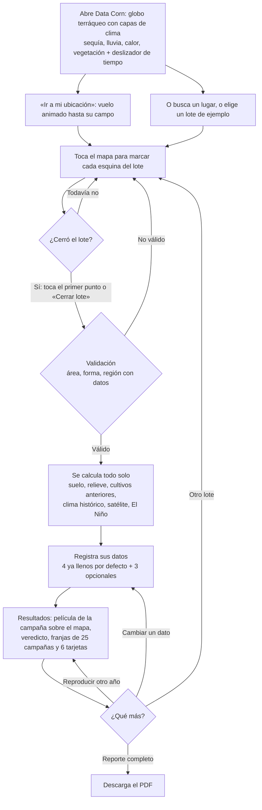
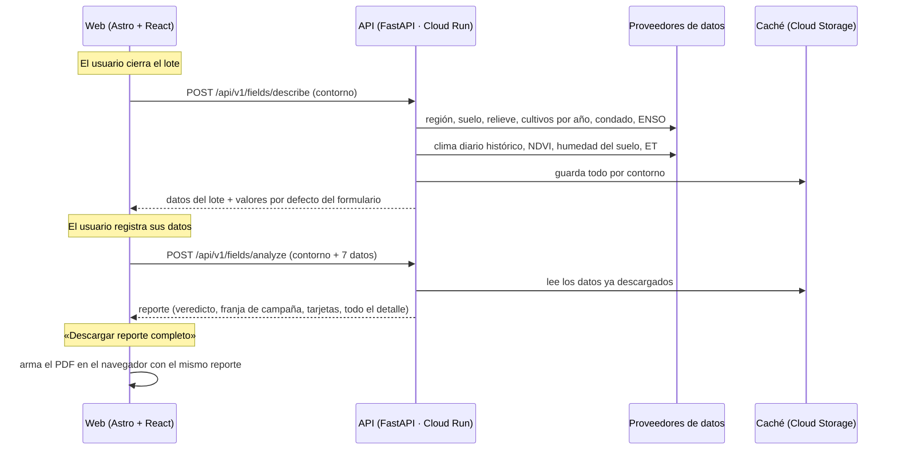

# Data Corn — Flujo de uso

Se empieza con la Tierra vista desde el espacio y se vuela hasta el lote. Se avanza un paso a la vez, y el clima y la campaña se ven sobre el mapa. El reporte completo se descarga en PDF. No pide login ni registro.

## 1. Flujo del usuario

## 2. Qué pasa detrás

El trabajo pesado se hace al cerrar el lote. Después del formulario solo queda calcular, y eso es inmediato.

## 3. Antes y durante la campaña: un solo cálculo

La campaña siempre se arma con los días ya observados hasta hoy. Los días que faltan se completan con escenarios de los años históricos de ese mismo lote.

| Momento | Días observados | Días con escenarios históricos | Qué ve el usuario |
|---|---|---|---|
| Antes de sembrar | ninguno | toda la campaña | riesgos esperados y la mejor fecha de siembra |
| Durante la campaña | desde la siembra hasta hoy | desde mañana hasta la cosecha | cómo va el lote y qué riesgos le quedan |
| Después de cosechar | toda la campaña | ninguno | repaso: qué pasó y por qué |

Los escenarios se pueden filtrar por fase de El Niño: si hoy hay El Niño, pesan más los años con El Niño.

Al 14 de noviembre de 2026, la demo muestra dos campañas:
- la campaña 2027, todavía antes de sembrar;
- la campaña 2026, ya cosechada, como repaso.

## 4. Pasos de la pantalla

| Paso | Qué se ve | Cómo se sale |
|---|---|---|
| 1. Globo | La Tierra en 3D con capas de clima (sequía, lluvia, calor, vegetación) y un deslizador de tiempo; el botón grande «Ir a mi ubicación»; enlaces para buscar un lugar o ver un ejemplo | Vuelo animado hasta la ubicación |
| 2. Dibujar | La guía «Toque las esquinas de su lote», los puntos y líneas, el área en vivo y los botones «Deshacer» y «Cerrar lote» | Al cerrar el lote |
| 3. Calculando | El lote dibujado y una lista de avance que se va marcando: ubicación, suelo y relieve, cultivos anteriores, clima, satélite | Al terminar (o con error) |
| 4. Sus datos | Panel sobre el mapa con un resumen de lo detectado, 4 datos ya llenos y los opcionales plegados | «Ver resultados» |
| 5. Resultados | El mapa grande con la película de la campaña (▶ día a día), el veredicto, las franjas de 25 campañas, las 6 tarjetas clave, el botón del PDF y los enlaces «Cambiar datos» y «Nuevo lote» | Cambiar datos, nuevo lote o PDF |
| Error | Qué pasó y qué hacer, sin perder el lote dibujado | Reintentar o volver a dibujar |

Errores previstos:
- **Ubicación denegada:** se ofrece buscar el lugar a mano.
- **Contorno inválido:** dice qué corregir (muy chico, muy grande o con lados cruzados).
- **Zona sin datos suficientes:** se calcula con fuentes globales y confianza baja, y se avisa.
- **Servicio caído:** botón para reintentar.
