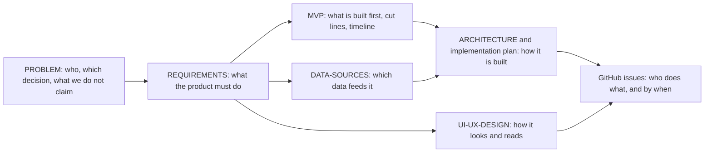

<!-- SI-assisted (Claude Code); reviewed by <name> -->
# Planning documentation

Index of the planning documents for Field Shift, Team DataCorn's entry to the NASA Space Apps Challenge 2026 ("Field Shift: Adapting Farms with NASA Data"). Start with the [project README](../../README.md) for the pitch, the status and the quickstart. Come here for the reasoning behind it.

These documents are drafts written on 2026-11-14 with SI assistance (see the header of each file). Facts come from this repository's own documents or from dated probes. Anything else is marked **to verify**.

## 1. The planning set

| Document | What it answers |
|---|---|
| [PROBLEM](PROBLEM.md) | Who the user is, the decision, why it is hard, what we do not claim, how it fits the challenge, prior art and the gap |
| [REQUIREMENTS](REQUIREMENTS.md) | What the product must do and how we will know. Every requirement is traced to the issue that delivers it. Open items. |
| [MVP](MVP.md) | What a judge or producer sees end to end, the Must, Should and Could cut lines, what is out of scope, success gates, timeline, risks |
| [UI-UX-DESIGN](UI-UX-DESIGN.md) | Audience, principles, page flow, key states, tokens, accessibility, voice, the story narrator, the name decision |
| [DATA-SOURCES](../DATA-SOURCES.md) | Every data source: product, access, accounts, probes, fallback. This is the file that issue [#16](https://github.com/RikepilB/Data_corn/issues/16) asks for. It is written and still to be reviewed against the live sources. |

How the documents feed each other:

## 2. Topic, epic and files

The backlog has ten epics ([#1](https://github.com/RikepilB/Data_corn/issues/1) to [#10](https://github.com/RikepilB/Data_corn/issues/10)) and 58 tasks beneath them ([#11](https://github.com/RikepilB/Data_corn/issues/11) to [#68](https://github.com/RikepilB/Data_corn/issues/68)). The outline, with cut lines and milestones, is in the [project README](../../README.md). The table says where each epic is documented. Requirement-level traceability (which issue delivers which requirement) is in [REQUIREMENTS](REQUIREMENTS.md) section 6.

| Topic | Epic | Tasks | Where it is documented |
|---|---|---|---|
| Team, repository and access setup | [#1](https://github.com/RikepilB/Data_corn/issues/1) | [#11](https://github.com/RikepilB/Data_corn/issues/11) to [#15](https://github.com/RikepilB/Data_corn/issues/15) | [Project README](../../README.md) (quickstart, contributing), [ACCOUNTS](../setup/ACCOUNTS.md), [DATA-SOURCES](../DATA-SOURCES.md) section 6 (accounts and connections), [MVP](MVP.md) section 6 (timeline) |
| Data sources: investigate, register, verify | [#2](https://github.com/RikepilB/Data_corn/issues/2) | [#16](https://github.com/RikepilB/Data_corn/issues/16) to [#21](https://github.com/RikepilB/Data_corn/issues/21) | [DATA-SOURCES](../DATA-SOURCES.md), [REFERENCES](../REFERENCES.md), [REQUIREMENTS](REQUIREMENTS.md) section 2.1 |
| Papers and scientific basis | [#3](https://github.com/RikepilB/Data_corn/issues/3) | [#22](https://github.com/RikepilB/Data_corn/issues/22) to [#26](https://github.com/RikepilB/Data_corn/issues/26) | [REFERENCES](../REFERENCES.md), [PROBLEM](PROBLEM.md) sections 7 and 8, [prior-art research](../research/ANTECEDENTES-maiz-EEUU.es.md) (Spanish), planned `docs/PAPERS.md` ([#22](https://github.com/RikepilB/Data_corn/issues/22)) |
| Validate the idea | [#4](https://github.com/RikepilB/Data_corn/issues/4) | [#27](https://github.com/RikepilB/Data_corn/issues/27) to [#31](https://github.com/RikepilB/Data_corn/issues/31) | [PROBLEM](PROBLEM.md) sections 5 to 8, [MVP](MVP.md) section 5 (gates), [REQUIREMENTS](REQUIREMENTS.md) section 7 (open items), planned `docs/validation/MENTOR-LOG.md` ([#27](https://github.com/RikepilB/Data_corn/issues/27), [#28](https://github.com/RikepilB/Data_corn/issues/28)) and `docs/validation/RUBRIC-SCORES.md` ([#31](https://github.com/RikepilB/Data_corn/issues/31)) |
| Clean Architecture and engineering foundation | [#5](https://github.com/RikepilB/Data_corn/issues/5) | [#32](https://github.com/RikepilB/Data_corn/issues/32) to [#34](https://github.com/RikepilB/Data_corn/issues/34) | [ARCHITECTURE](../architecture/ARCHITECTURE.md), [REQUIREMENTS](REQUIREMENTS.md) section 3 (non-functional), planned `.github/pull_request_template.md` ([#33](https://github.com/RikepilB/Data_corn/issues/33)) |
| Pipeline: adapters, domain, use cases (Python) | [#6](https://github.com/RikepilB/Data_corn/issues/6) | [#35](https://github.com/RikepilB/Data_corn/issues/35) to [#47](https://github.com/RikepilB/Data_corn/issues/47) | [Implementation plan](../superpowers/plans/2026-11-14-field-shift-mvp.md), [ARCHITECTURE](../architecture/ARCHITECTURE.md) section 4 (science notes), [REQUIREMENTS](REQUIREMENTS.md) section 2.1, [DATA-SOURCES](../DATA-SOURCES.md) |
| Web (Astro) and Firebase Hosting | [#7](https://github.com/RikepilB/Data_corn/issues/7) | [#48](https://github.com/RikepilB/Data_corn/issues/48) to [#53](https://github.com/RikepilB/Data_corn/issues/53) | [REQUIREMENTS](REQUIREMENTS.md) section 2.2, [UI-UX-DESIGN](UI-UX-DESIGN.md) sections 3 to 5, [MVP](MVP.md) section 2 (walkthrough), [project README](../../README.md) (status, quickstart) |
| UI/UX and brand | [#8](https://github.com/RikepilB/Data_corn/issues/8) | [#54](https://github.com/RikepilB/Data_corn/issues/54) to [#58](https://github.com/RikepilB/Data_corn/issues/58) | [UI-UX-DESIGN](UI-UX-DESIGN.md) (section 13 maps each task to the section that covers it), planned `web/src/styles/tokens.css` ([#55](https://github.com/RikepilB/Data_corn/issues/55)) |
| Storytelling and demo | [#9](https://github.com/RikepilB/Data_corn/issues/9) | [#59](https://github.com/RikepilB/Data_corn/issues/59) to [#63](https://github.com/RikepilB/Data_corn/issues/63) | [UI-UX-DESIGN](UI-UX-DESIGN.md) sections 9 and 10, [MVP](MVP.md) section 6 (timeline), planned `docs/story/STORY.md` ([#59](https://github.com/RikepilB/Data_corn/issues/59)) |
| Submission and compliance | [#10](https://github.com/RikepilB/Data_corn/issues/10) | [#64](https://github.com/RikepilB/Data_corn/issues/64) to [#68](https://github.com/RikepilB/Data_corn/issues/68) | [SUBMISSION-COMPLIANCE](../submission/SUBMISSION-COMPLIANCE.md), [REQUIREMENTS](REQUIREMENTS.md) section 5, [MVP](MVP.md) sections 5 and 6, [UI-UX-DESIGN](UI-UX-DESIGN.md) section 11 (brand rules) |

## 3. Reading order

| Reader | Read, in this order |
|---|---|
| A judge or mentor (about 10 minutes) | 1. [Project README](../../README.md). 2. [PROBLEM](PROBLEM.md) sections 1 to 3, 6 and 7. 3. [MVP](MVP.md) section 2 (what is seen end to end). 4. [DATA-SOURCES](../DATA-SOURCES.md) section 2 (summary table). 5. [UI-UX-DESIGN](UI-UX-DESIGN.md) sections 2 and 5 (principles, key states). |
| A teammate building a task | 1. [Project README](../../README.md) (quickstart, contributing). 2. The issue itself (acceptance criteria) and its row in section 2. 3. [MVP](MVP.md) sections 3 and 6 (cut lines, timeline). 4. The matching rows in [REQUIREMENTS](REQUIREMENTS.md). 5. The task in the [implementation plan](../superpowers/plans/2026-11-14-field-shift-mvp.md) and [ARCHITECTURE](../architecture/ARCHITECTURE.md). 6. The per-source table in [DATA-SOURCES](../DATA-SOURCES.md) if the task touches data. 7. [UI-UX-DESIGN](UI-UX-DESIGN.md) if it touches the web. |
| Someone preparing the submission | 1. [SUBMISSION-COMPLIANCE](../submission/SUBMISSION-COMPLIANCE.md). 2. [REQUIREMENTS](REQUIREMENTS.md) section 5. 3. [MVP](MVP.md) sections 5 and 6. 4. [UI-UX-DESIGN](UI-UX-DESIGN.md) section 11 (brand rules). |

## 4. Documents that were already in the repository

| Document | Language | Role |
|---|---|---|
| [Team action plan](../TEAM-ACTION-PLAN.es.md) | Spanish | Roles, schedule, mentor questions, brand and story notes. It is the origin of the Must, Should and Could cut lines, the checkpoint gates and the design tokens. |
| [ARCHITECTURE](../architecture/ARCHITECTURE.md) | English | Stack evaluation, Clean Architecture layers, science notes (what we may and may not claim), the pilot-field decision, risks |
| [Implementation plan](../superpowers/plans/2026-11-14-field-shift-mvp.md) | English | 15 test-driven pipeline and web tasks, with code-level detail |
| [REFERENCES](../REFERENCES.md) | English | Every cited source with its licence and status (planned, used, verified) |
| [ACCOUNTS](../setup/ACCOUNTS.md) | English | Status of the global offers and accounts |
| [SUBMISSION-COMPLIANCE](../submission/SUBMISSION-COMPLIANCE.md) | English | Verified submission rules and dates, and the pre-submit checklist |
| [Prior-art research](../research/ANTECEDENTES-maiz-EEUU.es.md) | Spanish | Existing corn tools, past winners and the reason for the pivot |

## 5. Planned documents that do not exist yet

Shown as code, not as links, because the files are not in the repository. Each appears with the issue that creates it.

| Planned file | Issue | What it will hold |
|---|---|---|
| `docs/PAPERS.md` | [#22](https://github.com/RikepilB/Data_corn/issues/22) | The scientific basis, paper by paper, next to a complete `docs/REFERENCES.md` |
| `docs/validation/MENTOR-LOG.md` | [#27](https://github.com/RikepilB/Data_corn/issues/27), [#28](https://github.com/RikepilB/Data_corn/issues/28) | The questions put to mentors and their answers |
| `docs/validation/RUBRIC-SCORES.md` | [#31](https://github.com/RikepilB/Data_corn/issues/31) | The self-assessment against the judging rubric |
| `docs/story/STORY.md` | [#59](https://github.com/RikepilB/Data_corn/issues/59) | The story outline: the orbital observer |
| `web/src/styles/tokens.css` | [#55](https://github.com/RikepilB/Data_corn/issues/55) | The design tokens |
| `.github/pull_request_template.md` | [#33](https://github.com/RikepilB/Data_corn/issues/33) | The pull request template for the contract-first workflow |

## 6. Conventions

1. **SI header.** The first line of every SI-assisted Markdown file is `<!-- SI-assisted (Claude Code); reviewed by <name> -->`, and the teammate who reviews the file replaces `<name>`. Other file types carry the same note in their own syntax (see Contributing in the [project README](../../README.md)).
2. **Status words.** `verified` (with the date of the probe or reading), `to verify` (nobody has checked it), `not used` (listed, but no plan task uses it). An unchecked number is never stated as fact.
3. **Issue links.** Always a full link such as [#16](https://github.com/RikepilB/Data_corn/issues/16), never a bare number, so the link works wherever the Markdown is rendered.
4. **Cut lines.** Must: no cut. Should: each falls back without breaking anything. Could: out unless everything else is green ([MVP](MVP.md) section 3).
5. **Requirement IDs.** R1 to R12 are challenge requirements, FR-nn functional, NFR-nn non-functional, SC-nn rules on what the science may claim, CR-nn submission and compliance, O1 to O7 open items. All are in [REQUIREMENTS](REQUIREMENTS.md).
6. **Source of truth.** If two documents disagree, the first in this list wins: the contract `contracts/ficha.schema.json`, then [ARCHITECTURE](../architecture/ARCHITECTURE.md), then the [implementation plan](../superpowers/plans/2026-11-14-field-shift-mvp.md), then these planning documents. Correct the lower one and tell the repository owner. For status and acceptance criteria the GitHub issue is the live source.
7. **Honest numbers.** Results are scenarios, not forecasts. Missing data is `NaN`, `null` or `not-available`, never 0.
8. **Links.** Relative links point only to files that exist in the repository. Planned files are written as code (section 5).
9. **People, time, units.** These documents name lanes and roles, not people. Times are PET (UTC-5). The pipeline works in metric units and the web shows US units (inches, degrees Fahrenheit, acres).
10. **Web path.** The web app lives in `apps/web/`, which came with the Data Corn skeleton merged on 2026-11-14. Documents written before that say `web/`. Read `web/` as `apps/web/` everywhere, including planned files such as `web/src/styles/tokens.css` and the ficha folder `web/public/data/fichas/`, and fix the path when a document is next edited.

## 7. Keeping the documents true

- **A source is added or changes:** update its row in [DATA-SOURCES](../DATA-SOURCES.md) (status and date) and add or update its row in [REFERENCES](../REFERENCES.md) in the same commit.
- **A to-verify item is resolved:** replace the words "to verify" with "verified" and the date, and say how it was checked. Remove it from the open items in [REQUIREMENTS](REQUIREMENTS.md) or [PROBLEM](PROBLEM.md).
- **The contract changes:** change `contracts/ficha.schema.json` first, then the pipeline and the web, then the requirement rows and the field names used in [UI-UX-DESIGN](UI-UX-DESIGN.md).
- **Scope changes:** update the cut lines in [MVP](MVP.md) and the outline in the [project README](../../README.md).

## 8. Glossary

| Term | Meaning here |
|---|---|
| Band | The p10, p50 (median) and p90 of one metric across the years in a matrix cell. |
| Confidence | A high, medium or low label on each matrix cell, set by how many years and corn years stand behind it and by the SMAP consistency check. The exact rule is requirement FR-08 in [REQUIREMENTS](REQUIREMENTS.md) section 2.1. |
| Consistency check (SMAP) | A comparison of monthly soil-moisture anomalies from the twin (rainfed run) with SMAP at its 9 km pixel, for the current rotation only. It never validates the alternative rotations. |
| Crop year | Crop year Y runs from 1 September of year Y-1 to 31 August of year Y. |
| Ficha | The JSON file the pipeline writes for one field and the web page renders. Its shape is fixed by `contracts/ficha.schema.json`. The word is Spanish for "record card" and is kept as the project's term. |
| LEMA | Local Enhanced Management Area, a Kansas groundwater-management tool. The Sheridan-6 LEMA is the one in the pilot area. The reduction in pumping and the corn-yield effect reported for it are self-reported and to verify ([#26](https://github.com/RikepilB/Data_corn/issues/26)). |
| Rainfed run and full-irrigation run | The soil-water twin runs twice per rotation. The rainfed run gives the stress metrics: what the crop would face without irrigation. The full-irrigation run gives the irrigation demand. |
| Rotation | A repeating sequence of crops on one field. Four are proposed for the pilot field: the current one (continuous corn, irrigated), corn then soybean, corn then a cereal rye cover crop then soybean, and a dryland wheat, corn, sorghum, fallow sequence. A mentor or an agronomist reviews them. |
| Scenario | What the historical record says would have happened in a year of a given type. It is not a forecast of the coming season. |
| SI | Super Intelligence, the 2026 Space Apps term for what earlier years called AI. |
| TAW and RAW | FAO-56 terms. TAW (total available water) is the water the soil holds between field capacity and wilting point over the root depth. Here it comes from SSURGO soil data, weighted over the root zone. RAW (readily available water) is the part of TAW the crop can use before it is stressed. |
| Tercile | One of three equal groups after the years are ranked. The driest third of crop years is the dry year type, the middle third is normal and the wettest third is wet. With 45 crop years each type would hold 15, if the full climate record is available (open item O1 in [REQUIREMENTS](REQUIREMENTS.md)). |
| VT-R1 | Tasseling (VT) to silking (R1), the corn stage most sensitive to water shortage. The pipeline uses a 21-day window from 7 days before to 14 days after the start of the FAO-56 mid-season stage. That window is to be confirmed against the FAO-56 text ([#23](https://github.com/RikepilB/Data_corn/issues/23)). |
| Year type | Dry, normal or wet. Each crop year is placed in a tercile of April to September rain from NASA POWER. A year missing more than 5 percent of its season's daily values is left unclassified, not guessed. |
