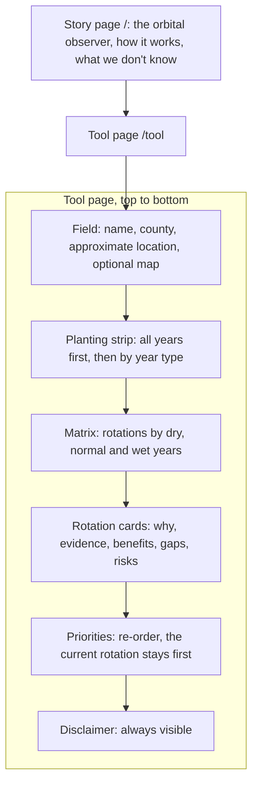

<!-- SI-assisted (Claude Code); reviewed by <name> -->
# UI/UX and design style

The design contract for the Field Shift web: who it is for, the principles, the page flow, the key states, the design tokens, accessibility, voice, the story narrator and the pending name decision. It is consistent with issues [#48](https://github.com/RikepilB/Data_corn/issues/48) to [#58](https://github.com/RikepilB/Data_corn/issues/58) (table in section 13). Index: [planning README](README.md).

There is no code here. Tokens are fixed in [#55](https://github.com/RikepilB/Data_corn/issues/55) and the wireframes in [#56](https://github.com/RikepilB/Data_corn/issues/56). Where this document proposes something the issues do not already say, it is marked **proposed**.

## 1. Audience and context of use

| | |
|---|---|
| Primary reader | A large or medium irrigated corn producer in western Kansas, deciding on a rotation and a planting date ([PROBLEM](PROBLEM.md)). |
| Also reads | Judges, mentors, extension contacts and teammates, on a phone or a desktop. |
| Device | **Phone first.** "A farmer reads this on a phone, in US units" ([#56](https://github.com/RikepilB/Data_corn/issues/56)). The layout must also work on a desktop screen. |
| Language and units | English. US units: inches, °F, acres. The pipeline stays SI; the web only formats ([#48](https://github.com/RikepilB/Data_corn/issues/48), [#57](https://github.com/RikepilB/Data_corn/issues/57)). |
| When | Around planting. In April nobody knows whether the summer will be dry. |
| Connectivity | Not surveyed. The site is static, and each ficha is one JSON file. |
| What is stored | Nothing. No login, no account, no saved field. |

**Product gate:** someone outside the team opens the public address on their phone and explains the matrix without help, within 2 minutes ([#58](https://github.com/RikepilB/Data_corn/issues/58)). The confusions are recorded in a comment, the top three become fix issues before the freeze, and the test is repeated with a second person after the fixes.

## 2. Principles

| # | Principle | On screen |
|---|---|---|
| 1 | **Support, do not replace.** | No "recommended" badge. Rotations are ordered by the producer's priorities and the current one stays first. Every card carries "risks for local review". |
| 2 | **Say "we don't know".** | Information gaps are visible. A missing value reads "no data". The SMAP note says "not available" when it is. The calendar says "assumed" when it is. A visible section lists what we don't know. |
| 3 | **Ranges, not false precision.** | The median is large and the p10 to p90 range is small. A confidence level with its reason sits on every cell. Priority fit uses levels (better, similar, worse, unknown), not scores. |
| 4 | **One decision, one user, one field.** | The tool page is about one field. No dashboard, no platform feel. |
| 5 | **Zero data entry.** | The rotation, soil and climate are pre-filled from public data. The only input is the priority toggles. |
| 6 | **Scenarios, not forecasts.** | The disclaimer is always visible and the copy never promises what will happen. |
| 7 | **Plain words first, jargon on demand.** | VT-R1, TAW, RAW and ET0 appear only in tooltips and the glossary ([#57](https://github.com/RikepilB/Data_corn/issues/57)). |

Principles 4 and 5, with "mark where the human decides" and US units, come from the lessons in the [prior-art research note](../research/ANTECEDENTES-maiz-EEUU.es.md) (section 3): decision tools fail when they ignore the user's own judgment or demand tedious data entry.

## 3. Information architecture and page flow

Two pages, and no login, account or settings page:

- **Story page `/`**: the orbital observer ([#59](https://github.com/RikepilB/Data_corn/issues/59), [#60](https://github.com/RikepilB/Data_corn/issues/60)). Hero, how it works (calendar, twin, year types), what we don't know, a button to the tool, data credits.
- **Tool page `/tool`**: the page a producer or judge uses ([#49](https://github.com/RikepilB/Data_corn/issues/49)).

The data lives in `/data/fichas/<site>.json`. It is a file, not a page.



The reading order follows [#56](https://github.com/RikepilB/Data_corn/issues/56). The disclaimer is a persistent element, not only the last block. The priority toggles change the order of the cards, so on a phone they may sit as a sticky control just above the cards; that is a wireframe decision (**proposed**).

**Every element is a rendering of a ficha field.** The web never computes science.

| Element | Ficha field | Priority |
|---|---|---|
| Synthetic banner | `provenance.kind` | Must |
| Field header | `site` (name, state, county) | Must |
| Planting strip | `planting` | Must |
| Matrix | `matrix` and `rotations` | Must |
| Rotation cards | `rotations[]` (why, evidence, benefits, gaps, risks) | Must |
| Priority toggles | `priorities` and `rotations[].priority_fit` | Must |
| Validation note | `validation` | Must |
| Calendar note | `calendar` | Must |
| Disclaimer | `disclaimer` | Must |
| Data credits | `provenance.inputs` | Must |
| Field map | `site` (lat, lon, approximate) | Should ([#50](https://github.com/RikepilB/Data_corn/issues/50)) |
| Regional water chart | `water_context` | Should |

## 4. Reading a matrix cell

Rows are rotations, with the current one first. Columns are Dry, Normal and Wet years, in that fixed order. Each cell holds four values and a confidence badge. `NN` below stands for a number from the ficha.

```text
+--------------------------------------------------+
| Dry years (NN years)               Confidence: Medium |
| Stress days if not irrigated      NN  (NN-NN) days    |
| Stress at tasseling-silking       NN  (NN-NN) days    |
|   (NN corn years)                                     |
| Irrigation needed                 NN  (NN-NN) in/acre |
| Bare-soil days                    NN  (NN-NN) days    |
+--------------------------------------------------+
```

The first number is the median in large type; the range in brackets is p10 to p90 in small type. The confidence reason opens on hover, tap or keyboard.

**On a 375 px phone, 12 cells do not fit side by side.** Two options for the wireframes (**proposed**, decide in [#56](https://github.com/RikepilB/Data_corn/issues/56)): (a) keep all three columns and scroll the matrix sideways inside its own container with the rotation names fixed; (b) show one year type at a time with a three-way switch. Whichever is chosen, all three year types stay reachable and labelled in words, the current rotation stays first, and the matrix stays a real table for screen readers.

## 5. Key states

| State | Trigger in the ficha | What the visitor sees | Never |
|---|---|---|---|
| Synthetic example | `provenance.kind` is `synthetic-example` | A red banner reading "SYNTHETIC EXAMPLE" on every page that shows the example, with a text label ([#49](https://github.com/RikepilB/Data_corn/issues/49), [#52](https://github.com/RikepilB/Data_corn/issues/52)) | Example numbers presented as results |
| Not-irrigated rotation | `irrigated` is false | The irrigation cell is muted and reads "Not irrigated: would need X in/acre to avoid stress" | A value that looks like water used |
| No data | A band is `null` | "no data". For the corn critical-stage value, a tooltip can say there are no corn years of this type (**proposed**, [#57](https://github.com/RikepilB/Data_corn/issues/57)) | 0, or a blank |
| Low confidence | `confidence` is `low` | A "Low confidence" badge, with the reason on tap. The cell stays visible. | Hiding the cell, or showing it like a high-confidence one |
| Consistency check | `validation.status` | The status as written (consistent, weak, inconsistent or not available) and the note about the mixed 9 km pixel | The word "validated" |
| Crop calendar | `calendar.status` | "Assumed from the field's recorded rotation" or "Detected from satellite NDVI" | An assumed calendar presented as detected |
| Planting window missing | `planting.status` is `not-available` | A short message that the window could not be computed | A strip of zeros |
| No regional water data | `water_context` is absent | The section is left out | An empty chart |
| Map fails to load | Network or script error | The text location stays. The page works ([#50](https://github.com/RikepilB/Data_corn/issues/50)). | A broken page |
| Ficha fails to load | The fetch fails | A plain error message with a retry | An empty matrix that looks like zeros |

## 6. Design tokens

From the [team action plan](../TEAM-ACTION-PLAN.es.md), section 7, and [#55](https://github.com/RikepilB/Data_corn/issues/55). They will live in `web/src/styles/tokens.css`, which does not exist yet. This document invents no colour.

| Token | Hex | Use |
|---|---|---|
| soil | `#6B4F3A` | Headings, soil |
| chlorophyll | `#3E7D4F` | NDVI, crop |
| water | `#2F6E9E` | Moisture, irrigation |
| dry | `#D9822B` | The dry-years column |
| wet | `#1F8A8A` | The wet-years column |
| normal | `#8A8F98` | The normal-years column |
| paper | `#F6F2EA` | Background |
| ink | `#1E1E1E` | Text |

**Dry to wet is orange to teal, with grey in the middle. Never red and green**, so the scale does not exclude colour-blind readers.

**Typography** (all under the SIL Open Font License, self-hosted, with licences recorded in [REFERENCES](../REFERENCES.md); its fonts table is still empty):

| Role | Font |
|---|---|
| Headings | Fraunces |
| Interface | IBM Plex Sans |
| Numbers and data | IBM Plex Mono |

The Space Apps fonts (Fira Sans and Overpass) are not used, unless we follow the Space Apps brand guide. The type scale is set in [#55](https://github.com/RikepilB/Data_corn/issues/55).

## 7. Accessibility baseline

From [#55](https://github.com/RikepilB/Data_corn/issues/55): text meets WCAG AA contrast on the paper background; the dry-to-wet scale is checked with a colour-blind simulator (not done yet); focus states are visible; reduced motion is respected.

### 7.1 Contrast of the current tokens

Computed on 2026-11-14 with the WCAG 2.x relative-luminance formula, from the hex values above. The script is kept outside the repo, and this is not a substitute for the checks in [#55](https://github.com/RikepilB/Data_corn/issues/55). AA asks for 4.5:1 for normal text and 3:1 for large text (at least 24 px, or 18.66 px bold) and for interface components and graphics.

| Pair (foreground on background) | Ratio | AA for normal text (4.5:1) | 3:1 (large text, components) |
|---|---|---|---|
| ink on paper | 14.93 | Pass | Pass |
| soil on paper | 6.71 | Pass | Pass |
| water on paper | 4.89 | Pass | Pass |
| chlorophyll on paper | 4.42 | **Fail**, by 0.08 | Pass |
| wet on paper | 3.72 | Fail | Pass |
| normal on paper | 2.91 | Fail | **Fail** |
| dry on paper | 2.62 | Fail | **Fail** |
| ink on dry | 5.70 | Pass | Pass |
| ink on normal | 5.13 | Pass | Pass |
| ink on wet | 4.02 | **Fail** | Pass |
| dry against wet (adjacent fills) | 1.42 | Not applicable | Not applicable |
| dry against normal (adjacent fills) | 1.11 | Not applicable | Not applicable |
| wet against normal (adjacent fills) | 1.28 | Not applicable | Not applicable |

Contrast is symmetric, so paper-coloured text on a soil, water or chlorophyll fill has the same ratio as the reverse pair.

### 7.2 What follows

1. **Body text is ink on paper** (14.93). Headings in soil (6.71) and links or labels in water (4.89) pass. Chlorophyll fails as text by a small margin: use it for fills and graphics, or let [#55](https://github.com/RikepilB/Data_corn/issues/55) adjust it.
2. **Dry, normal and wet are fills, not text colours.** Dry and normal fail even the 3:1 test against paper. Where they mark a column or a chart, add an ink or soil border so the shape does not depend on the fill.
3. **Text on a fill is ink.** It passes on dry (5.70) and normal (5.13). On wet it is 4.02, which is enough for the large median but not for small type such as the p10 to p90 range. How to treat text on the wet fill is a decision for [#55](https://github.com/RikepilB/Data_corn/issues/55). This document proposes no new hex value.
4. **Year type always carries a text label.** Dry and normal differ by only 1.11:1 in lightness, so a reader with colour-blindness, or anyone looking at a greyscale screenshot or print, cannot tell them apart by colour. Column heads say "Dry years", "Normal years" and "Wet years" in words, in a fixed order, and any chart labels its series directly.
5. **No state relies on colour alone.** The synthetic banner, the confidence level and the consistency status each carry text, and an icon where one helps.

### 7.3 Other requirements

Marked **proposed** where the issues do not already say so:

- Every interactive element has a visible focus state, and everything works by keyboard. The confidence reason and the tooltips open on tap and by keyboard, not only on hover.
- Reduced motion is respected (`prefers-reduced-motion`).
- The matrix is a real HTML table with row and column headers, so a screen reader announces "Corn then soybean, dry years, stress days" and not a bare number (**proposed**).
- The page language is English, every page has a title, and any chart has a text alternative (**proposed**).
- Touch targets are at least 44 px (**proposed** as a design target).
- The colour-blind simulator check of the orange, grey and teal scale is part of [#55](https://github.com/RikepilB/Data_corn/issues/55).

## 8. Voice and copy

From [#57](https://github.com/RikepilB/Data_corn/issues/57) and the team action plan, section 7.

- Short sentences.
- Numbers with a range: "30 days (24-36)".
- Say "scenario, not forecast".
- Say "we don't know" where we don't.
- Units: inches, °F, acres, and dates such as "Apr 23". No bu/ac: contract v0.2.0 has no yield metric.

**Plain labels**, with a short tooltip. The tooltip text is a draft for [#57](https://github.com/RikepilB/Data_corn/issues/57); lane B checks it against the agronomy sources ([#24](https://github.com/RikepilB/Data_corn/issues/24)).

| Ficha metric | Label on screen | Tooltip (draft) |
|---|---|---|
| `water_stress_days` | Stress days if not irrigated | Days the crop would have too little water if it got no irrigation. |
| `critical_stage_stress_days` | Stress at tasseling-silking | Stress days in the weeks around tasseling and silking, when corn is most sensitive. Counted only in years when this rotation grows corn. The length of the window is to be confirmed ([#23](https://github.com/RikepilB/Data_corn/issues/23)). |
| `irrigation_m3_ha` | Irrigation needed (in/acre) | The water that would keep the crop out of stress, in inches over one acre. It is not what is applied. |
| `bare_days` | Bare-soil days | Days with no crop on the field. |
| `erosion_index` | Erosion index (relative) | Compares rotations at this field only. It is not tons per acre. |
| `confidence` | Confidence: high, medium or low | The reason: how many years and corn years stand behind the cell, and whether the consistency check is available. |
| `planting` | Typically ready to plant. Last spring frost. | When soil is warm enough and a frost-free week follows, over all years in the record. |

**Say and avoid.**

| Avoid | Prefer |
|---|---|
| predict, forecast, will, guarantee | "in dry years in the record", "scenario", "historically" |
| best, optimal, recommended | "ordered by your priorities", "suggested for review" |
| validated (about the alternatives) | "consistency check of the current rotation" |
| jargon in headings (VT-R1, TAW, RAW, ET0) | plain labels, with the term in a tooltip |
| alarm about dry years | a neutral description of what the record shows |

**Fixed phrases (drafts):**

- Disclaimer: "Scenarios from historical climate, not forecasts. This tool supports your judgment and local agronomic advice. It does not replace them."
- Ordering: "Ordered by your priorities. Your current rotation always stays first."

## 9. The orbital observer

The story-page narrator, from the team action plan, section 7.

A visitor has looked at the same field every day since 1981. It knows nothing about farming. It sees only greens that rise and fall, wet and dry earth, and that some years, the dry ones, are different. It sees patterns, but it does not know what matters to the farmer, so it asks for the farmer's priorities. That humility is the message of the challenge: the tool supports and does not replace.

- **The narrator is not NASA.** No NASA logos, flags, mission patches or insignia anywhere, and no imagery that suggests an official NASA voice.
- **Voice:** short sentences, ranges, "scenario, not forecast", "we don't know". It admits what it cannot see and asks rather than tells.
- **Structure** ([#59](https://github.com/RikepilB/Data_corn/issues/59)): problem, the observer, what we found, what we do not know, impact. One page in `docs/story/STORY.md`, which does not exist yet.
- **The page** ([#60](https://github.com/RikepilB/Data_corn/issues/60)): hero, how it works (calendar, twin, year types), what we don't know, a link to `/tool`, data credits. It uses the tokens, is English only, shows the disclaimer and has no login.
- **Imagery (proposed):** abstract orbit lines and shapes in the token colours, nothing that looks like a mission patch.

Three draft lines to show the tone. The story owner rewrites them; they are SI-assisted wording:

- "I have watched this field every day since 1981. I know what the ground looks like. I do not know what you grow."
- "Some years the green did not come back. I can tell you which. I cannot tell you why it matters to you. Tell me what you care about."
- "This is what the dry years looked like. It is not what next summer will look like."

## 10. Name and tagline

Pending decision, [#54](https://github.com/RikepilB/Data_corn/issues/54). Options from the team action plan, section 7:

| Name | Tagline | Note |
|---|---|---|
| Surco | Your field's next rotation, tested against 45 years of climate. | The "45" depends on the length of the record (open item O1 in [REQUIREMENTS](REQUIREMENTS.md)) |
| Chacra 45 | 45 seasons of satellite memory for one field's next choice. | Same dependency on "45" |
| Field Shift | See which rotation holds up in dry years. | The challenge's own name. It is the working name in this repository. |

Criteria: the name is not a NASA mark and not an existing product (a quick search); there is no "nasa" in any domain ([#15](https://github.com/RikepilB/Data_corn/issues/15)); an SI-suggested name is declared in the SI field of the form ([#66](https://github.com/RikepilB/Data_corn/issues/66)); the README and the page titles are updated once it is decided. The domain question comes after the name: `fieldshift.earth` was available on 2026-11-14 and is not registered.

## 11. Brand rules

- No NASA logos, flags, mission patches or insignia in the site, slides, README or favicon ([#65](https://github.com/RikepilB/Data_corn/issues/65) audits them). NASA is named only as a data source.
- The visual identity is our own. The Space Apps logo and fonts are not used unless we follow their brand page.
- No vendor or commercial promotion.
- SI-generated images and video carry a visible watermark ([#66](https://github.com/RikepilB/Data_corn/issues/66)).
- Fonts, images, map tiles and icons are recorded in [REFERENCES](../REFERENCES.md) with their licences ([#22](https://github.com/RikepilB/Data_corn/issues/22)).

## 12. Open design decisions

| Decision | Options | Issue |
|---|---|---|
| Colour of the "SYNTHETIC EXAMPLE" banner. The plan says red, but red is not in the token set. | Define an alert token. The banner must carry its text label whatever colour is chosen. | [#55](https://github.com/RikepilB/Data_corn/issues/55), [#49](https://github.com/RikepilB/Data_corn/issues/49) |
| Token adjustments from the contrast table (chlorophyll as text, small text on the wet fill, borders for dry and normal) | Adjust the tokens or the usage rules | [#55](https://github.com/RikepilB/Data_corn/issues/55) |
| Matrix layout on a phone | Side scroll with fixed row names, or one year type at a time | [#56](https://github.com/RikepilB/Data_corn/issues/56) |
| Where the priority toggles sit | After the cards, or a sticky control above them | [#56](https://github.com/RikepilB/Data_corn/issues/56) |
| Copy for a `null` critical-stage value | "no data" alone, or with a "no corn years" tooltip | [#57](https://github.com/RikepilB/Data_corn/issues/57) |
| Name and tagline | Surco, Chacra 45 or Field Shift | [#54](https://github.com/RikepilB/Data_corn/issues/54) |
| Basemap for the field map | A free basemap with visible attribution | [#50](https://github.com/RikepilB/Data_corn/issues/50) |

## 13. Consistency with the web and UI/UX issues

| Issue | What it asks | Where this document covers it |
|---|---|---|
| [#48](https://github.com/RikepilB/Data_corn/issues/48) Ficha helpers | `formatBand` ("30 (24-36) days", "no data"), US-unit formatters, a missing cell is null and not 0 | Sections 4, 5 and 8 |
| [#49](https://github.com/RikepilB/Data_corn/issues/49) Tool page | Planting strip first, matrix, cards, toggles, validation note, disclaimer, synthetic banner, year-type colours, no login | Sections 3 to 6 |
| [#50](https://github.com/RikepilB/Data_corn/issues/50) Field map | Optional, approximate location, the page works if it fails | Sections 3 and 5 |
| [#51](https://github.com/RikepilB/Data_corn/issues/51) Smoke test | 12 cells, planting strip with 3 year-type rows, "Not irrigated" row, visible disclaimer, no password input | Sections 4 and 5. Each state is visible text, so it can be tested. |
| [#52](https://github.com/RikepilB/Data_corn/issues/52), [#53](https://github.com/RikepilB/Data_corn/issues/53) Deploy | The synthetic banner is visible on v0; no login on v1 | Section 5 |
| [#54](https://github.com/RikepilB/Data_corn/issues/54) Name | Three options, checks, SI declaration | Section 10 |
| [#55](https://github.com/RikepilB/Data_corn/issues/55) Tokens | Tokens, OFL fonts, orange to teal, AA contrast, focus, reduced motion | Sections 6 and 7 |
| [#56](https://github.com/RikepilB/Data_corn/issues/56) Wireframes | Page order, the drawn states, p50 large with a small band, confidence reason on tap | Sections 3 to 5 and 12 |
| [#57](https://github.com/RikepilB/Data_corn/issues/57) Copy | Plain labels, voice, US units, rotation wording checked by lane B | Section 8 |
| [#58](https://github.com/RikepilB/Data_corn/issues/58) Usability test | An outsider explains the matrix in 2 minutes on a phone | Section 1 |
